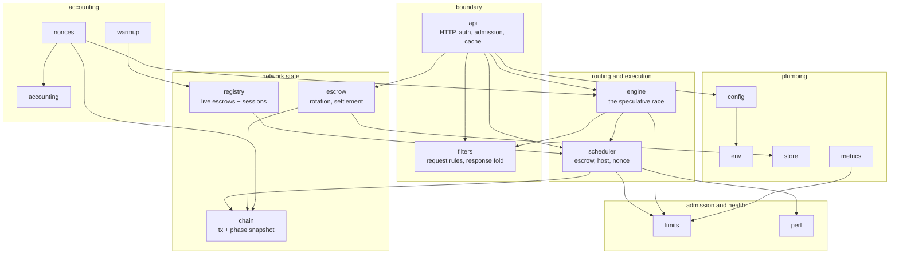
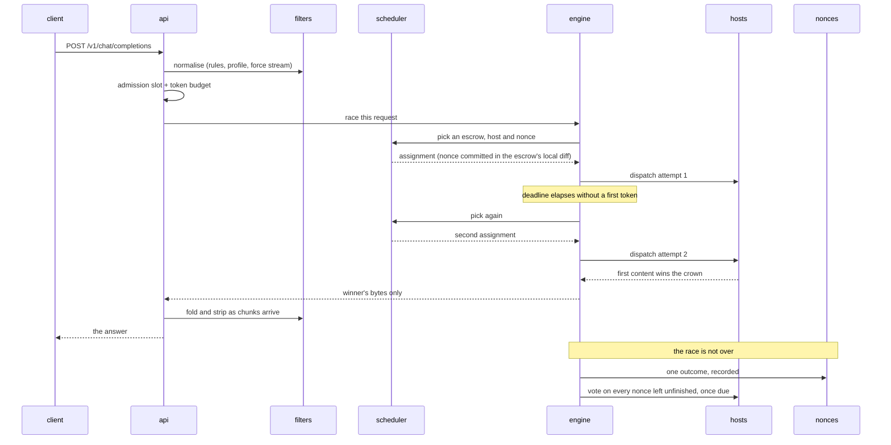
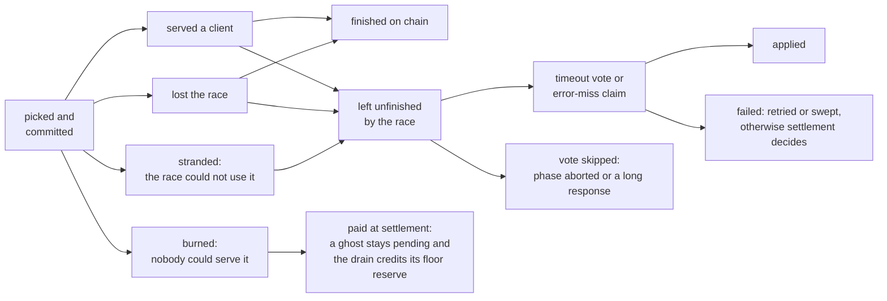

# Architecture

## The problem this shape solves

A normal API gateway forwards a request and forgets it. This one cannot, for three reasons:

1. **A nonce costs money the moment it is committed**, before anyone is served. A request that fails still leaves an obligation on the chain.
2. **Hosts are untrusted and uneven.** Any of them can be slow, wrong, or lying, so the answer a client gets is raced across several and the loser's cost still has to be accounted for.
3. **The network moves underneath.** Escrows deplete and rotate, epochs change phase, hosts join and leave — all while requests are in flight.

Every structural choice below follows from one of those.

## Layers

An arrow points from a package to one it imports.

`filters` depends on nothing: it is pure, and its behaviour is pinned byte-for-byte against goldens. `env` is read once at startup and never again. Everything else reads an immutable `config` snapshot that is swapped whole on reconfiguration.

The graph shows the layer packages, so the composition root, `app`, is not on it: `app` imports every box above and `app/compose.go` wires them, and the four adapters that hand one event to two readers — a race outcome to the metrics recorder and the nonce ledger, a warmup's vote to that same recorder without a race's line, a burn to its log line, its metric and the ledger, a phase poll to a line only when something changed — live in `app/observers.go` rather than in a layer package. See the root [`README.md`](../README.md), "Two readers of one fact".

## One request

Two things in that diagram are the whole design:

- **The client is answered before the request is finished.** The crown goes to the first attempt producing content; the losers are still running, and their nonces still owe votes. A client hanging up does not cancel them.
- **The nonce is committed at pick time, not at success time.** That is why a burned nonce, a refused host and a stranded assignment all have names and all reach the ledger.

## A nonce's life

Every nonce ends in exactly one of these, and the ledger's job is to say which:

Losing the race is not a failure: a loser whose host finished its nonce owes no vote, and the race posts only for the nonces it left unfinished, after its outcome is recorded (`engine/engine.go`, `Engine.record`; `engine/settle.go`, `RaceOutcome.TimeoutPlan`). A posted vote is not a timeout applied either, so the ledger records each vote as completed, skipped or failed (`engine/settle.go`, `TimeoutOutcome`). A nonce the ledger cannot place on this graph is money the escrow paid for silence. That is the failure mode the whole accounting layer exists to make visible.

## Where the money is

Three places, each with its own guard:

| Risk | Guard |
| --- | --- |
| a committed nonce nobody settles | the race's drain barrier: shutdown waits, within its grace period, for the owed votes that fall due inside it; a refusal vote due later is lost at the restart and finalize pays that nonce in full |
| an escrow that pays for work it did not receive | [`accounting`](../accounting/) cross-checks its own counts against the chain's |
| a reply held in memory until the process dies | a per-request cap, a process-wide ceiling, and folding as chunks arrive |

## What runs in the background

Beyond the request path, the process runs: the chain phase observer, the escrow lifecycle manager (rotation, depletion, settlement), the nonce ledger's sweep, the escrow warmup, the host pings, the runtime-params feed and, when it is on, the height follower. Each is started by the composition root and stopped by it in order — the race's drain barrier right after the HTTP server, before anything it may still need to pay the chain what it owes ([`operations.md`](./operations.md), "Shutdown").
