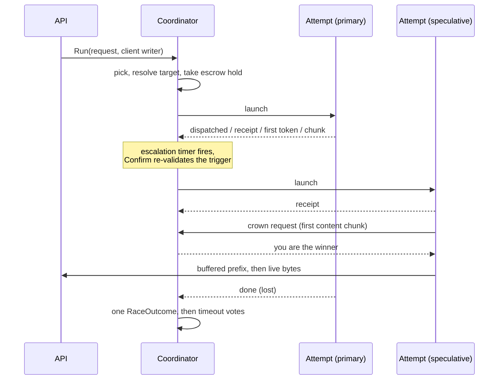

# Devshard gateway — the speculative race

One client request is a *race*: one to N attempts against distinct participants, of which at most one is crowned and streamed to the client. Speculation exists because a devshard host can fail in ways that a timeout alone does not catch — it can answer instantly with nothing, receipt and then never produce a token, or simply be much slower than a peer. Racing turns those into a latency cost rather than a failed request.

This document covers `engine/`. Where a nonce comes from is in [routing.md](./routing.md); the invariants the engine must not break are in [rules.md](./rules.md).

## Anatomy

Each attempt runs in its own goroutine and communicates with the coordinator only by events. The coordinator owns the race state and is the only thing that decides anything.

## Crowning

**A winner is crowned by its first chunk of actual content** — not by a receipt, not by the first token, and not by HTTP 200 (`engine/classify.go`, `chunkSignal.crownsWinner`; `engine/crown.go`, `raceCoordinator.answer`).

A host that responds instantly with an empty stream wins on any earlier signal, and the client gets nothing while a slower, honest host is cancelled. Requiring content means the empty host loses to whoever produces tokens.

The mechanics are a handshake, not a flag. An attempt's writer buffers everything it receives while it has produced no content; on the first chunk that carries content it sends a crown request and **blocks** on the reply (`engine/stream.go`, `winnerWriter.Write` and `winnerWriter.claim`). So no byte reaches the client before the coordinator has settled on a single winner. The coordinator's answer is you are the winner or you are suppressed, and a suspicious host's claim is **held** until it can be answered honestly. A suppressed attempt's writer then discards its buffered prefix and clears its client field entirely — a loser has no reachable sink at all, rather than a sink reachable behind a branch. Suppression is permanent, which is why the claim is held rather than refused early: an attempt refused a crown can never be given one, so refusing it while a rival might still fail would throw away an answer the race has already paid for.

A suppressed attempt keeps reporting successful writes to its host, so the host keeps streaming to its own receipt. Its bytes go nowhere.

**The crown gives up a pick still waiting.** A hedge or an immediate attempt whose pick has not been answered yet is cancelled the moment a winner is crowned, and none is started after it (`engine/crown.go`, `raceCoordinator.crownWinner`). The scheduler withdraws the waiter before it draws a nonce; a nonce it had already drawn is handed over and sent, its output discarded, because the commit has already reserved that request's cost. Left running, the pick would draw nonces that serve nobody.

The buffered prefix matters for correctness of the visible stream: role announcements and comment chunks that arrive before the first content are flushed to the client in order, ahead of the chunk that won. The prefix is bounded the way reassembly is: 1 MiB per attempt, 10 MiB per host and 100 MiB across the gateway (`engine/prefix_budget.go`). A host that streams events with no content can otherwise hold an attempt's buffer until its hard timeout, and every attempt it is dispatched multiplies that. An attempt past its own or its host's share is ended and reads as a response too large; one past the gateway's share is ended too, but that is the gateway's pressure rather than the host's answer, so it is spared on both ladders (`ExemptGatewayPressure`). A writer whose race is already over buffers nothing, because no claim can flush it (`engine/stream.go`, `winnerWriter.buffer`).

### An SSE error event counts as a chunk but never crowns

An error event increments the attempt's chunk count — so the stream is *not* empty — while carrying no content, so it cannot crown (`engine/attempt.go`, `attemptState.record`; `engine/classify.go`, `chunkSignal.crownsWinner`). That combination is what distinguishes "the host said something went wrong" from "the host said nothing", and the two are charged differently.

A **capability refusal** is a third case and is kept out of the error class entirely (`engine/reassembly.go`, `sseClassifier.facts`): it must neither count as a chunk nor end the race, while its message still reaches the performance recorder. After a tool or version refusal another host can still serve the request (`engine/capability.go`, `CapabilitySignal.Retriable`); a trusted host's context-length rejection ends the escalation unless a host running the model's full length could still serve the request (see [Escalation](#escalation)). On a refusal the engine records the host's capability limit (`engine/capability.go` → `perf/tracker.go`, `RecordContextLimit`). Nothing routes on it: the count is reported so an operator knows what to fix.

### Crown denial

A host that repeatedly answers with no content stops being crownable, and keeps receiving attempts until the breaker cuts it off for leaving nonces open. Three content-free answers cost the crown; one content-bearing answer buys it back immediately (`engine/engine.go`). While denied, the host is treated as suspicious: a race that starts with it launches a speculative attempt immediately, and its claim on the client stream is held for as long as **any rival could still serve**. A rival is one already running that has not claimed, one whose pick is in flight, and one the race has committed to starting but not yet picked for — the replacement a suspicious primary earns is a rival from the moment the race decides to fetch it, not from the moment it launches. When none is left the held claim is crowned, because then its answer is the one the race committed a nonce for and refusing it would hand the client an error for a response that exists (`engine/race.go`).

The operator's manual suspicious-host pins fold into the same gate, so a pinned host escalates and is held back however well it has been answering.

A held claim is answered once no rival can serve, and also once every running rival has missed its receipt or first-token deadline with no token to show: a silent rival past its deadline is not worth holding the client for until its hard timeout, and the held host's answer is the one the race already has (`engine/crown.go`, `raceCoordinator.rivalsMissedTheirDeadline`, crowned as `rivals_missed_their_deadline`). A deadline excused during proof of compute does not count as missed, and a rival that has started streaming is still waited on.

An empty stream that burned completion tokens on an empty-answer route is *not* a content-free answer: it is a model outcome, and the host is innocent. The check that separates them reads the host-reported usage — and it is allowed only on an empty-answer route, because anywhere else any host could fake a usage object to escape the empty-stream penalty. A request is on that route when the profile the filters resolved for it sets `empty_answer_counts_tokens` (the `kimi` preset does): the flag travels with the request (`filters.Result.EmptyAnswerCountsTokens` to `engine.Request.EmptyAnswerCountsTokens`), so the engine never looks a profile up again and one request sees one profile. An operator can set it only for a model the chain registers.

## Classification and reassembly

The classifier reads an attempt's SSE stream incrementally and yields, per chunk, whether it carried content, an error, a capability refusal, and how many tokens the host claims to have burned.

TCP does not deliver event-aligned chunks, so a carry buffer reassembles events split across reads and classifies each exactly once, when its final line arrives (`engine/reassembly.go`, `sseClassifier`). The unterminated final event is classified on flush, before emptiness is decided, so a host is not charged for an empty answer it did not give.

Reassembly is charged against three budgets — per attempt (1 MiB), per participant (10 MiB) and process-wide (100 MiB). The participant level is the one that matters: it stops a single host that never terminates an event from draining the shared pool and starving every other host of classification (`engine/carry.go`, `carryBudget`). A cap trip releases the fragment and classifies the raw chunk instead, so classification *degrades* rather than stopping, and the first trip is reported once as a metric. A trip on the global budget undoes the participant charge, because a charge left behind on a trip is quota nobody can return.

A complete event is never charged. The transport writes an event and its terminator into the attempt in one write, and caps one event at `DefaultMaxSSEEventBytes`, which is `MaxJSONResponseBytes` (16 MiB), rather than at the attempt budget, because a host that does not stream writes its whole answer, forced logprobs included, as a single event ([`transport/client.go`](../../../transport/client.go), `writeSSELine` and `DefaultMaxSSEEventBytes`).

## Escalation

The escalation policy is **pure**: a function of its arguments and the configured thresholds, with no chain snapshot and no clock of its own. It reads no host performance data either — the race reads the outlier detector and hands `Decide` a boolean, so the policy's whole input is its argument list (`engine/escalation.go`).

Stages that can trigger another attempt. The reason column is the wire string an escalated attempt carries on `devshard_gateway_attempts_started_total{role="speculative",reason}` (`engine/escalation.go`, `EscalationStage.Reason`):

| Reason | When |
|---|---|
| `suspicious_host` | The first attempt's host is crown-denied or operator-pinned — escalate immediately. |
| `receipt_timeout` | No receipt within the receipt timeout (doubled above 100 000 input tokens, because admitting a very large prompt is itself work). |
| `first_token_timeout` | No first token within the first-token deadline. |
| `slow_start` | No receipt or no first token by the slow-start hedge, which falls before the judged deadline of the stage the attempt is in. |
| `attempt_failed` | An attempt ended without producing anything usable, an empty stream that closed its nonce included. |
| `stalled_before_content` | An attempt that streamed but never produced content went quiet for the inter-chunk stall: a role chunk or empty deltas prove nothing, so the race does not wait on them. |

An attempt launched at race start beside a primary the race distrusts carries a start reason rather than an escalation reason on `devshard_gateway_attempts_started_total{reason}`, and the two vocabularies do not overlap: `primary_suspicious` for a crown-denied or operator-pinned host, `primary_degraded` for one the outlier detector wanted out of rotation. The second exists because the routing gate that withholds an ejected host is capped, and a fleet failing together stays routable by design — see [capacity.md](./capacity.md).

The first-token deadline is a fixed quadratic in prompt size, `1.7 + 3e-5·T + 5e-10·T²` seconds, `T` the prompt's byte estimate (`engine.Request.InputTokensFromBytes`, the normalized body's bytes over four) that the curve, the receipt doubling and the fleet's first-token scale were fitted on, whatever the request's token count, with a floor from `engine_first_token_floor_ms` (`engine/escalation.go`, `EscalationPolicy.firstTokenTimeout`). At the default floor of six seconds the floor is what binds for ordinary traffic: the quadratic only overtakes it above roughly 67 000 input tokens.

**A slow start is hedged before it is judged.** The receipt and first-token deadlines are what a host is judged on; the hedge is a second, earlier deadline that starts a second attempt without waiting for either one to be judged. With `engine_hedge_first_token_floor_ms` above zero, the receipt and first-token escalations arm at `send + max(engine_hedge_first_token_floor_ms, curve × fleet scale)` once the model's fleet has a scale, and at `send + max(engine_hedge_first_token_floor_ms, curve)` until it does, where the curve is the same quadratic without `engine_first_token_floor_ms` (1.7 seconds for a small prompt). Either way the hedge arms whenever it falls before the judged deadline of the stage the attempt is in, and carries the stage `slow_start_wait_elapsed` and the reason `slow_start` (`engine/escalation.go`, `EscalationPolicy.hedgeBefore`).

**The hedge is measured against the fleet, not against a fixed time.** A second host rescues a request only when the first is slower than the others are now; when every host slows together, a second attempt finds a host as slow as the first and only adds the work that slowed them. The share of first attempts a hedge at a wait `d` doubles is `P(T > d)`, so a fixed `d` turns a fleet-wide slowdown into a fleet-wide hedge, and the extra work deepens the slowdown it reacts to. Each model keeps one fleet tracker (`engine/fleet_first_token.go`) over the first attempt of every race that started on a trusted primary: on its first token the attempt records the level `y = ln(time to first token / curve)`, which is near-normal across prompt sizes once divided by the curve. Over the last `fleetWindow` (30 s) the tracker takes the median `μ` and the scaled median absolute deviation `σ = 1.4826 × MAD`, and the fleet scale is `e^(μ + 2.33σ)`: on a healthy fleet about one first attempt in a hundred crosses it, and when every host slows, `μ` moves with them and the share stays the same. One slow host barely moves a median, so its attempts still cross the scale and are hedged. A first attempt still waiting for its token past the fleet's typical wait counts at its current age, so the scale rises during a slowdown rather than after the slow tokens arrive; one that ends without a token, or is abandoned, leaves the tracker when the race retires it and counts for nothing. Below `fleetMinimumSamples` (50) tokens in the window the scale is unknown and the fixed curve and floor apply. The floor still binds once the scale is known, so a fast fleet hedges no sooner than it did. Each attempt takes the scale once, at launch, the way it takes its host's first-content p75: `plan()` runs on every event, and a deadline that moved under a running timer would make `Confirm` refuse the hedge it armed. The scale is recomputed at most once per `fleetScaleRefresh` (1 s), and a caller whose clock reads earlier gets the cached one. Second attempts never feed the tracker, and neither does the primary of a race that started two at once: a hedge wins because the first attempt was slow, so its winners would read the fleet as faster than it is, and a distrusted primary is a host already known to be slow. The ring holds `fleetSampleCapacity` (4 096) tokens, so the window spans the full 30 s up to about 136 first tokens a second per model; past that it spans the most recent 4 096.

Before a receipt the escalation therefore fires at the earlier of the receipt deadline and the hedge, and after one at the earlier of the first-token deadline and the hedge. On a prompt large enough that the curve reaches the judged deadline, the judged stage arms exactly as it did without a hedge.

The judged deadlines do not move. `owedDeadline` still reads `receiptDeadline` and `firstTokenDeadline`, so a host's windows are narrowed at the receipt and first-token deadlines and never at the hedge, and the hedged attempt keeps running and can still win the crown. The host's own first-content p75 extends only the judged deadline: the hedge exists to rescue the client from a slow host, not to wait longer for it.

A hedge is its own stage so that `devshard_gateway_attempts_started_total{reason="slow_start"}` counts how often it fires, and the floor and the fleet constants can be tuned from production data. It starts an attempt the attempt budget already allows, so it moves when the second attempt starts, not how many a race may hold. `0` turns it off and leaves the judged deadlines as the only escalation points.

**An escalation the escrow cannot pay is not sent.** Every escalation picks the escrow the race already holds, and one whose balance, already net of the attempts the race started, cannot pay this attempt answers `ErrPinnedEscrowShort` and marks nothing ([routing.md](./routing.md), "Picking an escrow"). The race traces it as a `RaceStepEscalationUnfilled` step (logged as "escalation unfilled"), launches nothing and goes on with the attempts it has; that error reaches the client only when the race holds no attempt at all (`engine/pick.go`, `applyPick`; `engine/race.go`, `runRace`).

**An escalation may go on past the nonce cutoff, on half the in-flight margin.** Every speculative pick a race makes is marked `Escalation` (`engine/pick.go`, `startPick`), and the scheduler lets it use the race's escrow past the cutoff that stops new requests, both while the escrow is still a candidate and after the escrow was retired for its nonce cap and is draining, as long as the escrow's latest nonce is below the hosts' cap less half the in-flight margin ([routing.md](./routing.md), "Picking an escrow"). Without it, a race that started in the seconds before its escrow reached the cutoff and landed on a faulted host had no rescue at all: in prod-like-15m, 68 escalations were refused with `pinned escrow gone`, and their requests waited 45-70 s for the faulted primary. Each rescued request costs about one nonce, plus any nonce burned on the way to a host it does not exclude, taken from the half of the margin escalations are allowed; the other half stays for the timeout and validation diffs of the races in flight. Past the bound the escalation is unfilled, as before.

**Arming is not permission.** `NextEscalation` yields an `ArmedEscalation`, which is a deadline and nothing more. The only producer of an actionable escalation is `Confirm`, which re-derives the trigger *at fire time* and rejects a trigger that has vanished, a stage that has advanced, or a timer that fired early (`engine/escalation.go`, `ArmedEscalation` and `EscalationPolicy.Confirm`). This exists because an attempt's stage moves while its timer runs — a receipt landing just under the receipt timeout is the common case — and escalating on the armed stage would start a needless extra attempt on *every* healthy request. Confirming re-reads state, so the type system enforces it: an unconfirmed `ArmedEscalation` carries a deadline and no permission, and cannot be acted on.

The trigger is consumed *before* the new attempt starts, so a failed start cannot retry the same trigger (`engine/race.go`).

The escalation pick runs on its own goroutine rather than inline in the coordinator loop (`engine/race.go`). The scheduler may hold the nonce briefly for a co-arriving request, and a crown claim is the client's first token: waiting for the pick inside the loop would spend that hold on exactly the latency escalation exists to avoid. A departing client cancels the pick, which returns the nonce and the slot unless the nonce was already committed; a committed one is sent like any other attempt.

**There is one ladder, because there is one reply shape.** The gateway asks every host to stream whatever the client asked for ([`filters/README.md`](../filters/README.md), "Streaming is forced upstream"), so every request has a first token to wait for and every attempt that ends without one is escalated on the spot. There is no buffered rung. A `response_timeout_retry` deadline scaled by an output-token rate configured at 50 against a measured 25 a second models half the real time, so its floor decides every fire, and a rung that never fires on its own terms reads as coverage it does not give. `engine_non_stream_response_floor_ms`, `engine_non_stream_response_ceiling_ms`, `engine_per_output_token_response_lag_ms`, the one-shot retry they gate and its exemption from the attempt budget do not exist.

**Scarcity overrides speculation.** When the chain is blocking requests and the relaxed bypass is not active, the attempt budget collapses to one: a speculative attempt spends a nonce the phase the gateway is serving through will not replace, and so would the replacement of a failed one, so none is started. The rule is read once, from the snapshot `begin` takes, and admission already refuses a request in that phase before and after the limiter (`api/admission.go`, `admission`), so a race meets it only when the phase turns between admission and its first pick; the race does not re-read it for later picks, and the authority on what may still be spent is the scheduler, which refuses a nonce the escrow cannot pay (`engine/race.go`, `raceCoordinator.begin`).

**A refusal that rules out a retry ends the escalation.** A capability refusal is retriable when it belongs to the answering host's build — a tool call or protocol version it lacks — so another host may still serve the request (`engine/capability.go`, `CapabilitySignal.Retriable`). vLLM refuses a context it will not take with a 400 body that the host relays as a stream event after its receipt, and `filters.CapabilityLimits` reads the host's limit and the request's total from it ([`filters/README.md`](../filters/README.md), "Capability errors"). A context-length rejection is final only when no other host could serve the request: the model's context length is unknown, the rejecting host already runs it, or the request's total exceeds it. Otherwise the host runs shorter than the model and the race moves on to a host that may run the whole length (`engine/capability.go`, `CapabilitySignal.ServableByALongerHost`). Nor is it final when the gateway's own count contradicts it: when the request's byte-estimated prompt (`engine.Request.InputTokensFromBytes`) plus its output budget is at most half the model's context length, a host claiming the context is exceeded has missed, not answered for every host, and the race moves on and treats its refusal as it treats a shorter host's (`engine/capability.go`, `CapabilitySignal.servableElsewhere` and `contextEstimateMargin`). The margin absorbs the estimate's error, which reads bytes rather than tokens; a request near the model's length is still taken at the host's word. The model's context length is the `--max-model-len` the chain registers in the model's `ModelArgs`, else the operator's `model_limits[m].max_model_len` (`chain/grpc.go`, `maxModelLenOf`; `config/config.go`, `Limits.ContextLength`), read once when the race starts. It is not the length the participant limiter prices a window by, governance's `Model.context_window` ([capacity.md](./capacity.md), "The participant limiter: IOCW"): that one is what governance declares, while `--max-model-len` is the argument every host's vLLM is started with, and a refusal is only comparable against what the hosts run. Like `context_window`, a value above `config.MaxContextTokens` is read as none. The broker drops a host's own `--max-model-len <value>` pair ([`decentralized-api/broker/broker.go`](../../../../decentralized-api/broker/broker.go), `Broker.MergeModelArgs`), yet a host whose rejection names a shorter limit is running something else, so its word is not taken for every host's. A trusted host's rejection of the request itself rules out a retry too, because every host receives the same normalised body and the next host would repeat it (`engine/capability.go`, `rejectsRequest`). A rejection is an error event from an attempt that streamed no content, with a numeric `code` of 400 or a class that `HostApplicationError.HTTPStatus` maps to 400, which `filters.IsCacheableUpstreamError` accepts as an error about the request rather than the host ([`filters/README.md`](../filters/README.md), "Cacheability"). A message with no code and no class, a tool or version refusal, an answer that streamed content before its error, and a 404, 408, 422, 429 or 5xx still move on. A trusted host is one the race does not hold suspicious (see [Crown denial](#crown-denial)); the network does not verify a refusal or a rejection, so a suspicious host's refusal or rejection rules out nothing. Once a trusted host's refusal or rejection rules out a retry, the race arms no further escalation, gives up a pick still in flight, strands one that has already answered, and lets the attempts still running finish (`engine/capability.go`, `rulesOutRetry`; `engine/report.go`, `raceCoordinator.complete`). The client gets that host's error unless the crowned attempt carries its own (`engine/failure.go`, `RaceOutcome.hostError`). A refusal from a host running shorter than the model is not that answer: another host's own error outranks it, a host that failed without explaining itself leaves the client the race's generic error rather than a limit the model does not have, and only when every attempt was such a refusal does the client get the one naming the longest limit any host offered (`RaceOutcome.longestShorterHostRefusal`).

## Deadlines

One re-armed timer carries every deadline. `nextDeadline` takes the earliest of five families — the hard timeout, the escalation, the missed deadline, the pick and the stall — and the declaration order of the trigger constants breaks *exact* ties only (`engine/race.go`, the `deadlineTrigger` constants; `engine/deadline.go`, `nextDeadline`):

1. **Hard timeout** — the minimum of: the drain deadline once the client has left; the loser grace after a crowned attempt finishes; and 20 minutes per live attempt.
2. **Escalation** — the next armed trigger, suppressed while a pick is already running, and once the race is crowned, detached, at its attempt budget — holding as many unfinished attempts as `engine_max_attempts_per_request` allows, or having started as many as its host group has — or once a trusted host's refusal or rejection of the request rules out a retry.
3. **Missed deadline** — the earliest receipt or first-token deadline a running attempt still owes: the deadline its escalation arms on unless the slow-start hedge armed it earlier, armed whether or not the race may still escalate, and judged once per attempt.
4. **Pick** — when an unanswered escalation pick stops being worth waiting for; zero while no pick is running.
5. **Stall** — the earliest `last content chunk + inter-chunk stall` over attempts that have streamed and gone quiet. It runs from the first chunk of any kind, and only a chunk that carries content — `content`, `reasoning`, `reasoning_content` or a non-empty `tool_calls`, the same test that crowns — moves it, so a role chunk followed by silence, or a stream of empty deltas, stalls like a silent host, while a model that only reasons for a long time is content all along and never does (`engine/attempt.go`, `attemptWriter.Write`; `engine/deadline.go`, `markStalls`).

The tie-break order is itself the policy: a race that must stop gains nothing from spending a nonce, an escalation shares its instant with the deadline it arms on and the rescue goes first, and a stall is telemetry for an attempt that has content, which is crowned and arms no escalation, but escalates (`stalled_before_content`) an attempt that has none. For the same reason a rival past its deadline counts as having missed it until it sends content, not until it sends its first chunk (`engine/crown.go`, `rivalsMissedTheirDeadline`).

**A missed deadline narrows the host, not the attempt.** When a running attempt passes its receipt or first-token deadline, the race narrows its host's congestion windows on the spot and leaves the attempt running (`engine/deadline.go`, `raceCoordinator.judgeMissedDeadlines`): its nonce is committed, and cancelling it after the receipt would leave an execution-kind timeout holding the escrow for half an hour instead of an answer. Both deadlines narrow by the severe factor, and they differ in what they blame: a receipt is owed before any prefill, so a missed one narrows both windows, while a missed first token is prefill's own failure and narrows the input window, the output one taking the cross factor ([capacity.md](./capacity.md), "The participant limiter: IOCW"). A window judged only when the attempt ends would keep admitting work to a host that takes minutes to start, for all of those minutes. The answer that eventually arrives earns no wider window (see the limiter row under [The three translations](#the-three-translations)). A deadline that passes during proof-of-compute generation is excused: that phase slows every host at once, and narrowing the whole fleet for it would turn the minutes after it into ghost burns. The attempt's finish line names each deadline its host was narrowed for, as `missed_receipt_deadline` and `missed_first_token_deadline`, and `devshard_gateway_participant_missed_deadlines_total{deadline}` counts them per host and model.

**A host's clock starts when its request leaves, not when its nonce is committed.** A host more than one catch-up chunk behind is first taught every earlier nonce, and concurrent sends to it share that one catch-up, so a fresh escrow taking a burst can hold a request for tens of seconds before it is sent. The attempt runs that catch-up first and stamps its send time after it (`engine/attempt.go`, `runAttempt`; `user.Session.CatchUpBeforeSend`), so neither the receipt deadline nor the slow-start hedge counts the gateway's own wait against the host. Timed from the commit, the wait read as a slow host: the hedge spent another nonce on the same escrow, which every host had to apply too, the backlog grew faster than the hosts applied it, and the escrow reached its nonce cap with honest hosts narrowed for missed receipts. While the catch-up runs the attempt owes no deadline and arms no escalation, but for a minute at most: past `maxCatchUpBeforeSend` its clock starts anyway (`engine/deadline.go`, `liveAttempt.clockStart`), so a host still applying a long backlog is hedged and judged on its receipt rather than holding a request with no rival until the hard timeout. The catch-up is the host applying diffs at its own pace, so a deadline missed past that minute counts against it the way any other miss does. A catch-up the host does not answer at all is not that: the first chunk try that comes back with no HTTP status and no host's Connect code (`http2: client connection lost`, `peer rpc session not ready`, a refused dial) starts the clock at that moment, if that is earlier than the minute (`user.Session.awaitHostCatchUp`, `OnCatchUpFault`; `engine/attempt.go`, `AttemptCatchUpFaulted`). The receipt deadline and the hedge then arm from the fault, so the race gets a rival a few seconds after it rather than after the catch-up's four tries give up, which took 42 s for a paused host in prod-like. The signal is per host, not per run: a send queued behind another send's catch-up, or arriving after the host's last try failed and before a chunk landed, starts its clock at once. A host that answers, storage_busy and other statuses included, keeps the full minute. The hard timeout runs from the attempt's launch regardless (`deadlinePlan.hardTimeout`). A catch-up that fails ends the attempt unsent, classified as a failed send.

**A panic while a host's reply is read ends that attempt, not the process.** The send runs in the attempt's own goroutine, where nothing above it can recover, and the transport and the stream classifier decode bytes the host chose there. `SendRecovering` turns a panic inside `SendOnly` into a failed send whose error carries the panic's value, classified as any other send failure against that host (`registry/send.go`, `SendRecovering`, called by `api/dispatch.go` and the warmup probe). The recovery covers `SendOnly` alone and stops before the reply is applied: `ProcessResponse` holds the session lock, and a panic recovered there would leave the lock held and the escrow frozen, where a crash at least restarts the session from its store. The decoders themselves are kept from panicking in the first place ([`filters/README.md`](../filters/README.md), "Which JSON decoder, and why").

**Every select arm that reads race state drains the event queue first.** A buffered event and a fired timer can both be ready, and `select` picks at random, so an arm that reads state without draining acts on state a queued event has already invalidated. Three arms read state a queued event can change: the deadline timer, the pick's answer and the client's departure (`engine/deadline.go`, `engine/pick.go`, `engine/race.go`).

## Client departure and the drain

A client disconnect does not kill the race. The receipt, the response the session applies to its own state, and the vote that settles a committed nonce all have to complete after the client is gone.

The race context is `context.WithoutCancel` of the client's context: cancellation is dropped, values are kept (`engine/drain.go`, `drain` and `newDrain`). Writes to a departed client are reported as successful rather than failing, because a write error would end the attempt carrying them and the host that earned the crown still owes its receipt (`engine/drain.go`, `clientStream`).

The departure is read where a nonce is requested, not only where the select takes it: `begin` waits for the primary's pick under the client's context, so the scheduler gives up a pick still waiting when the client leaves, and `startPick` requests no speculative pick once the client has gone, even for an escalation that falls due as it leaves (`engine/race.go`, `raceCoordinator.begin`; `engine/pick.go`, `raceCoordinator.startPick`).

That check guards the commit, not the send. A nonce the scheduler committed before the client left is still returned, and the race sends it on the race context and discards its output (`scheduler/request_pick.go`, `Scheduler.pickOnce`; `engine/pick.go`, `raceCoordinator.applyPick`), as devshardctl does. The commit put a `MsgStartInference` with the request's own `max_tokens` in the escrow's diff: a record never sent stays `StatusPending`, and settlement charges its whole reserve to the escrow and credits it to the host. A refusal vote is no way out either, since it would count a `Missed` against a host that never received the request. Only a race that ruled every send out — the backstop cancelled it, or the request was refused as too long for any host — strands the nonce instead.

From departure onward the drain deadline is what bounds the race — forty minutes by default, and by construction longer than any deadline a race arms for itself, so the only host it ever ends is one that streams forever without tripping any other bound (`engine/drain.go`, `defaultDrainTimeout`).

Once the winner has finished, the client's request handler is released and any still-pending losers are handed to a second `await` on a background goroutine. Nothing they can do changes what the client received (`engine/race.go`, `runRace` and `raceCoordinator.release`).

`Run` calls the request's `OnFinished` exactly once, after the race's last report: before it returns for a race that ends while its client waits, from that background goroutine for one that outlives its client or its winner, and also when a stopped engine refuses the race or the race panics (`engine/engine.go`, `Engine.Run`). The handler holds its limiter slot until then ([request.md](./request.md), step 12).

## The outcome

Everything the race learned is folded into one `RaceOutcome`, and one field decides everything downstream: `Terminal`.

There are twenty-five terminal values, `Unclassified` among them, and every downstream vocabulary — limiter verdict, performance sample, metric label — is a *total function* of it (`engine/terminal.go`, `Terminal`). The HTTP-status recovery and the SSE inspection that decide the terminal therefore happen once, where the error and the bytes are, instead of being re-derived at each consumer.

`Rejected` is the one terminal whose scope is not obvious from its name: it covers every upstream 4xx that is neither throttling nor one of the named statuses, because those describe the request, not the host's ability to serve, so they move nothing (`engine/terminal.go`, `TerminalRejected`). A 5xx is the opposite case and gets its own terminal: the host answered but what it serves the request from did not, so `UpstreamServerError` narrows both windows by the hard factor on its own verdict, `UpstreamFault`. That verdict exists because the host demonstrably answered: unlike a throttle it must not clear the count of unanswered faults the breaker opens on, or a host alternating 5xx answers with connection resets would never be cut off.

The exception is a 5xx that names a fault in what the gateway sent. A host reports every diff it cannot apply as a 500 carrying the error's text — an escrow it cannot find, a nonce past the chain's cap, a balance, a payload hash — and none of those is the host's doing, so `transport.IsUpstreamRequestFault` keeps them a `Rejected` that blames nobody. The predicate matches on the shared error sentinels rather than a list of phrases, so the two sides cannot drift apart.

### The three translations

| Consumer | Rule |
|---|---|
| Limiter verdict | Won/Lost → success, or model outcome, which moves no window, when its host left the nonce unconfirmed or unfinished, or late success when its host missed the receipt or first-token deadline, which clears the cut-off's count without widening a window; throttled, unavailable and an attempt the streaming backstop cut → overload, soft on both windows, counting towards the cut-off when the host carried nothing else of ours for this model as the refusal landed — counted live by the coordinator, not by the race's report — and leaving its count alone otherwise; an upstream 5xx → upstream fault, hard on both windows and leaving the cut-off's count alone; a stall between chunks → decode stalled, severe on output and cross on input, and no business of the cut-off's; the remaining transport-class terminals, among them an answer its host closed with neither `[DONE]` nor a finished nonce, a loser's included → transport fault, which moves no window and counts towards the cut-off; an empty stream → empty answer, hard on both windows, or, when the stream left its nonce open, severe on both and counting towards the cut-off; a burn-empty the host held past the chain's refusal timeout → overload; a burn-empty inside it, an error stream, a capability refusal and a reply past the gateway's own buffer cap → model outcome, which never moves a host's window. The factors are in [capacity.md](./capacity.md), "The participant limiter: IOCW". |
| Performance sample | One sample per attempt, unless the exemption ladder excuses it. The sample carries participant, model, whether the host was responsive, and the two timings the escalation ladder reads back as quantiles. |
| Metric labels | Bounded label vocabularies exported by the engine and referenced — not restated — by the metrics layer. |

An empty stream narrows its host whether or not it closed the nonce: a client can render nothing from it, and another host given the same prompt usually can, so the race escalates on it at once and both windows narrow (`engine/escalation.go`, `EscalationPolicy.triggerFor`; `engine/judgement.go`, `RaceOutcome.Verdict`). A host that said nothing and also left the nonce open took the work and parked the reserve until the timeout vote, so it answers to the breaker as well as to crown denial. A burn-empty stays a model outcome and starts no other attempt: the thinking budget went on reasoning, and another host given the same prompt would spend it the same way.

### Counting what an attempt produced

`logprobs` is forced on for every inference by the executor (`common/completionapi.ModifyRequestBodyWithLogprobsMode`; the gateway carries the client's ask, `filters/table.go`), and the copy a host streams back keeps it for a client that asked for logprobs, or for every client when the logprobs optimization is off (`common/completionapi/responseprocessor.go`; `GATEWAY_LOGPROBS_OPTIMIZATION_OVERRIDE`), so such a chunk carries one `logprobs.content` entry per token the host generated. The gateway counts them as the chunks arrive (`engine/classify.go`, `chunkScan.LogprobTokens`), which gives it a token count that does not depend on the host reporting one and that exists for an answer cut off half way.

`AttemptOutcome.OutputTokens` prefers the host's own `usage.completion_tokens` and falls back to that count. The host's number is authoritative where it exists — it is what the chain is handed and what the escrow pays against — but a fleet contains runtimes that ignore `include_usage`, and a stream the race cancelled never reaches its usage chunk at all. Either way the reply the client received is worth a number, and the count off the wire is the only one available.

The two can disagree, and where they do the gateway's request ledger says what the gateway saw while the nonce ledger says what the chain recorded ([accounting.md](./accounting.md), "Money and tokens"). That disagreement is a fact about the host's runtime, not about the gateway.

**An attempt past its reservation is counted against its host, never cut.** The nonce was priced on the request's `max_tokens`, `Request.OutputTokens`, and a host whose `OutputTokens` passes it runs a build that ignores the limit; the chain caps the cost at the reservation, so the host works unpaid past it. The client still receives every byte. The report records an output overrun against the host and model (`engine/engine.go`, `Engine.record`; `perf/capability.go`), served as `output_overruns` in the nonce ledger's `capability` object ([accounting.md](./accounting.md), "What a host is allowed to be doing"). Like a capability refusal it is counted and reported, never routed on.

### Reading an empty answer back

An attempt that ends `empty_stream` or `burn_empty` says the classifier found no content in the bytes that arrived, and that fact alone does not say which of two things happened: the host sent events carrying nothing, or it sent something the classifier could not read. An event whose `delta.content` is typed against the schema — an array of parts where the shape expects a string — fails every decode the classifier has, and is dropped whole, taking its `usage` block with it (`engine/classify.go`, `decodeEvent`). Both cases reach the log as the same two zeroes.

So the line carries both what the host said and what the gateway could not read, because one does not answer for the other.

**What the host said** is already decoded by the classifier, which parses every event once: the line carries `finish_reason`, `usage_prompt_tokens` and `logprob_tokens` beside `usage_tokens` (`journal/render_race.go`, `appendEmptyAnswerFields`). Those four say whether the host thinks it produced anything at all, and a host reporting zero completion tokens has answered the question on its own.

**What the gateway could not read** is the raw head of two chunks, kept while no chunk has classified as content (`engine/chunk_head.go`, `attemptState.keepChunkHeads`):

- **the first**, because that is where a `delta` arrives and so where a decode the classifier lost would show;
- **the last**, because that is where the terminal event and its `usage` arrive.

Keeping only the last is not enough, and that is what this started as: the last contentless chunk is systematically the terminal usage event, which says nothing about a delta that never decoded. Where one chunk is both, it is offered once.

The stream's terminator is neither: the transport forwards `[DONE]` as a write of its own, so it is the last thing every well-formed stream delivers and would otherwise be the head of every empty answer alike. It is trimmed the way the chunk-gap measurement already trims it, and a write that was nothing else leaves the previous heads standing (`filters/sse.go`, `TrimSSEDone`).

**The head elides what the gateway asked for and strips again.** Every request runs with `logprobs` and `return_token_ids` ([request.md](./request.md), "The rule table") and the gateway removes them from the reply, so from a host that still returns them a contentless chunk is mostly `prompt_token_ids`: a 49 000-token prompt returns its ids as some 225 kB of numbers, which is the whole chunk. Copying its first few hundred bytes would spend the budget on ids and never reach the delta beside them. So each of those values is replaced by a marker as the head is built, and the head resumes after it (`engine/chunk_head.go`, `elideBulkyValues`). A value the log can read — a `"logprobs":null` — is left as it is, because the marker would hide an answer rather than a bulk. Skipping a value costs one pass over it, which the classifier's own decode has already paid for.

Four bounds keep a head from becoming a copy of the answer: it stops at `maxEmptyChunkLogged` and is validated as UTF-8 before it is kept, it is only taken while no chunk has classified as content, and it is offered on the outcome only for the two terminals that mean the gateway read nothing (`engine/attempt_outcome.go`, `attemptState.emptyChunkHeads`). An answer that reached the client carries no head at all.

A head is host output, so it is untrusted text in a log line, and it is bounded rather than sanitised beyond its encoding: what a host sends is what a reader needs to see.

### The exemption ladder

Whether an attempt contributes a performance sample at all is decided by one ordered ladder, applied in `Engine.record` and nowhere else (`engine/judgement.go`, `RaceOutcome.sampleExemption`).

1. Never dispatched — the attempt exists only because of the gateway's own bookkeeping.
2. Never reported — the attempt returned no terminal at all, so there is nothing to judge it on.
3. Ended by a proof-of-compute phase transition — blame the transition, not the host.
4. Error stream or capability refusal.
5. State-divergent.
6. The gateway's own post-state root was unavailable (`user.ErrLocalRootUnavailable`, wrapped as `engine.ErrLocalRootUnavailable` in `api/dispatch.go`) — its store failed, the host did nothing; unlike a divergence, the host is not excluded, rewound or blocked. A send to a slot the session opened without a client (`user.ErrHostAbsentFromChain`) takes the same rung: the host was never contacted, so it moves neither the cut-off nor the ejection, and the scheduler is told to stop binding that host on that escrow alone ([routing.md](./routing.md), "A slot the chain did not list at open").
7. The gateway's own pressure — the attempt was ended because the prefix budget across the gateway was full (`ExemptGatewayPressure`); the host's answer did not overrun its own or its host's share.
8. Long response after content — the host produced output, its nonce is still open, and the attempt has run past the exemption window, so the delay is a slow answer rather than an unresponsive host. An attempt the twenty-minute backstop cut does not take this rung; it is judged on its own terminal.
9. Empty stream while the proof-of-compute bypass is active.
10. A body the gateway refused to send — the host never saw the request, so nothing about it is the host's.
11. A host whose unknown-escrow lookup budget is spent — a `429` carrying `X-Devshard-Error: escrow_lookup_limited` (`transport.IsEscrowLookupLimitedError`). Strangers spent the budget the host shares across escrows, so the host is not overloaded: `TerminalEscrowLookupLimited` moves no congestion window, records no sample, is excused in the ledger, and the escalation still tries another host. The header is the host's own word, so it is believed for three refusals in a row per host and model (`engine/lookup_refusals.go`); past that the refusal is judged as the throttle it would otherwise be, and any other answer from the host restores the trust.
12. Empty stream in a race nobody won.
13. Cancelled by the race itself — a sample would say the host was unresponsive when it was told to stop. Except a loser of a served race that had already missed an unexcused receipt or first-token deadline and produced no token: the miss came before the cancellation, so it is recorded as unresponsive (`RaceOutcome.silentPastDeadline`), and a host that keeps hanging is degraded and ejected instead of starting single attempts that wait a full deadline each time.

Two parallel ladders use the same facts for different questions: the *verdict* ladder decides whether a congestion window moves, and the *timeout-skip* ladder decides whether a vote is posted. The sample ladder disagrees with the verdict ladder in exactly one place. A loser the race cancelled needs no verdict rung, because no terminal maps `client_cancelled` to a verdict at all; it does need a sample rung, because a recorded sample would report the host as unresponsive when the race is what told it to stop. That is rung 13.

Rung 10 is the same shape for a different cause. A host-bound body carries the escrow's catch-up diffs beside the prompt, and past what a host accepts the session refuses to send it — `transport.ErrHostRequestTooLarge`, raised after the nonce is already committed. Left unclassified it reached `TerminalDialFailure`: a negative perf sample, a push on the host's cut-off breaker, a `transport_error` in the ledger against the host's failure rate, and a 502 inviting a retry that would fail identically. The host saw none of it. `TerminalRequestTooLarge` names it, its verdict is a model outcome so no congestion window moves, the ledger excuses it the way it excuses a cancelled client, and the escalation still runs — the backlog belongs to this escrow, so another host is worth trying. The boundary keeps a reserve so that most of these are refused with a 413 before a nonce exists at all ([request.md](./request.md)).

### Timeout votes

Every attempt whose nonce the host did not finish gets a vote posted, with one of four recorded skip reasons where it must not be (`engine/settle.go`, `RaceOutcome.timeoutSkipReason` and `RaceOutcome.TimeoutPlan`): the attempt was aborted by a phase transition, the stream was empty and the nonce already finished, the nonce is already finished, or the response ran long after producing content.

A host whose escrow state diverged still gets its vote posted. Divergence is a routing fact — the scheduler blocks the host permanently — while an unposted vote leaves an orphaned start message that settlement can never resolve (`engine/settle.go`, `RaceOutcome.timeoutSkipReason`).

A vote that fails is written down as a warning naming the request, the nonce, the host and the reason, because a vote is the only thing that undoes a charge; the one exception is an escrow gone from the chain, which fails every vote it owed at once and has its own line already. Posting is handed to the queue below rather than run beside the race, because the protocol wait is measured in minutes and a goroutine per wait is what a fleet-wide outage multiplies. The engine's registration for that race is released only inside that goroutine, after the last post of every deadline group the race owes, its retries of a refused vote below included (`engine/engine.go`, `Engine.settle` and `Engine.retryRefusedVotes`). The started event is reported before the post and the result after it (`engine/settle.go`, `settleSteps`): each report reaches the metrics synchronously on the settle goroutine, while its ledger fact and any line are only queued, for the journal's consumer to deliver (`app/observers.go`, `nonceAccountedRaces.RecordTimeout`).

A vote carries each verifier only the diffs its own cursor is missing, not the escrow's whole append-only log (`user/session.go`, `catchUpDiffsForVerifier`). A voter has to be caught up to the record it is judging and no further, and the cursor already says where it is, having been advanced only by what a host itself acknowledged. A verifier that turns out to be behind fails its vote, and that failure rewinds its cursor through `forgetHostState`, so the next round teaches it the whole chain again: every nonce more than one catch-up chunk behind goes ahead in chunks before the vote, read from the store where memory no longer holds it, and the vote carries only the last chunk ([request.md](./request.md), "A session keeps only the newest diffs in memory").

One external quirk is absorbed at the boundary: the shared session's timeout handler returns a **non-nil error on its success path**, so a posted vote is recognised by the handler's own `Applied` flag rather than by `err == nil` (`engine/session.go`, `SessionTimeouts.SettleTimeout`). The one failure that would otherwise be structurally indistinguishable from a posted vote — a diff the group carried without the timeout — is marked at its source with `user.ErrTimeoutNotApplied`, so a caller reading the error alone does not count it as one (`user/timeout_effect.go`, `timeoutSettledError`).

### Error misses

A host that answers with its own error envelope did not go silent: it finished, signed a `MsgFinishInference` over that error body, and would be paid for it if the nonce were left alone. That nonce is claimed as a **miss** rather than voted as a deadline nobody met (`engine/settle.go`, `SettleByMissClaim`).

The claim is evidence, not judgement. A verifier recomputes `sha256` of the response payload and compares it against the hash inside the Finish the executor signed, so the gateway has to hand back the host's own event lines byte for byte (`host/timeout.go`, `VerifyErrorMiss`). The lines are retained while the stream is still speculative and released the moment the attempt turns out to be anything else, because most attempts are (`engine/miss_proof.go`, `errorStreamRetainer`). Two lines never count toward the hash: the `devshard_receipt` and `devshard_meta` events the host wraps around its answer after taking the hash. A stream that outgrew the retention bound, or whose reassembly dropped bytes, is marked truncated — the proof would hash to something else, and a claim that cannot be recomputed is worse than no claim.

**The Finish is held until the claim is posted.** The host's `MsgFinishInference` reaches the session in the same reply as its error, and the next diff anyone composes -- a heartbeat, another request's start -- would carry it into the log as an ordinary finish, after which the claim finds no Finish to prove against and falls back to a vote on a finished nonce. So every reply's Finish is pinned before the reply is applied (`api/dispatch.go`, `escrowTarget.Send`), an attempt that has no miss to claim lets it go the moment it is judged (`engine/attempt.go`, `holdFinishForClaim`), and an attempt that has one keeps it held through its `MissProof` until the race's votes are posted, whatever they came back as (`engine/engine.go`, `Engine.settle`). The race takes the held Finish when it applies the attempt's terminal event (`MissProof.takeHeldFinish`); an attempt that outlives its race releases what the race never took: when the event could not be handed over, when it landed in the event buffer after the race reported (the attempt checks `Reported` after the send), and `report` drains whatever is left in that buffer (`releaseUnreadFinishes`). Each Finish is released at most once. The claim itself waits on the record's own vote deadline like every other step, so the hold can last as long as that wait; the heartbeat and every other diff go on around it. An ordinary settlement cannot overtake it, because the race keeps the escrow busy until its votes are posted; a forced one can, and then finalize runs without the held Finish, the record is still `Started` when the state machine seals it, and the host is paid its reserved cost like every other request a forced settlement cuts off ([operations.md](./operations.md), "Settling an escrow that is still busy").

Two skips are deliberately overridden for a miss. The nonce **is** finished — that is the whole point, and the ordinary "already finished" skip would let the error be paid for. And a claim with no signed Finish behind it falls back to the ordinary vote, because every verifier would reject it as `no_finish_tx` (`engine/session.go`, `SessionTimeouts.settle`).

A landed miss comes back as `user.ErrInferenceMissed`, which is the protocol reporting a settlement as an error because the nonce did not finish normally. It is read as completed, not failed (`engine/settle.go`, `TimeoutOutcome`).

### The served stream

The bytes a client received and the `MsgFinishInference` the executor signed are tied together: the Finish carries `served_hash`, and the transport hashes every non-empty SSE line as it arrives (`transport/client.go`, `ReceivedResponseHasher`). After a reply is applied, the dispatch hands those sums to the session (`api/dispatch.go`, `escrowTarget.Send`), which pairs them with the Finish once it applies, in either order, and judges the pair `bound` when any sum equals the Finish's `response_hash` or `served_hash`, `mismatch` otherwise (`user/served_binding.go`). A stream that never completed carries no sums and is never judged, so an abandoned attempt, a phase-transition abort or a cut connection cannot strike anyone; probes go around the dispatch and are never bound.

The verdict arrives whenever the Finish applies, which is usually after the race has ended, so it is not part of the outcome and does not climb the exemption ladder below: it is the one perf sample that does not come from `Engine.record`. The registry hands it to an observer named with the escrow and its model (`registry/registry.go`, `observeServedBindings`); every verdict is counted in `devshard_gateway_served_bindings_total{model,verdict}`, and a mismatch is narrated (`journal`, `HostServedUnsigned`) and costs that host one unresponsive sample (`perf`, `Tracker.RecordServedMismatch`), the same currency as any other stall, so repeated mismatches eject it through the ordinary perf path. Nothing goes to the chain: the binding is the gateway's own check that it served what the host signed. The same observer tells the engine the Finish applied, whatever the verdict, which decides a served winner's held sample (below). The observer runs under the session's lock, which is why it only touches the perf tracker, the engine's held samples, the journal's non-blocking emit and the counter, none of which ever calls back into a session.

### A served winner's sample waits for its finish

A host signs its `MsgFinishInference` after its stream ends, and the Finish usually reaches the session in a later reply: milliseconds to seconds after the attempt reported done, and soonest relative to the stream on a host co-located with the gateway. Read at that moment, the nonce of a winner that served a whole answer is still open, and `responsive` would record the winner as unresponsive; enough of those would eject the fastest hosts.

So a winner that ended `Won`, confirmed, with its nonce still open, and that earns a sample at all (`engine/judgement.go`, `RaceOutcome.FinishAwaited`), is held instead of recorded (`engine/winner_sample.go`), and is decided once, by whichever comes first:

- **The Finish applies.** The served-binding observer above forwards every Finish it judges to `Engine.OnFinishApplied`, which decides the held winner as finished (`app/served_binding.go`, `finishNotice`). A Finish the binding never judges, because the stream carried no sums, is left to the vote.
- **The winner's vote is posted.** The open nonce is already in the race's timeout plan, held on the vote queue until its execution deadline. Once that group's post returns, a winner still held is decided as finished if the nonce reads finished by then, and as still open otherwise (`Engine.decideHeldWinners`).

Holding a sample adds no wait of its own: no goroutine, no timer and no deadline beyond the vote's. The race's registration keeps its dispatch target for as long as the vote is owed, so the nonce can be read at the post, and the `Stop` barrier covers the wait. A Finish that applies between the attempt's end and the hold is caught by reading the nonce once more right after the sample is held. The cost is on the other side: a host that serves whole answers and never finishes their nonces earns its unresponsive samples only as each execution vote falls due, half an hour after it confirmed the work, rather than as each race ends.

What waits is the sample and the winner's metric labels. Decided as finished, the winner records a responsive sample, a winner's success on `devshard_gateway_attempts_terminal_total` (`user_visible_winner`, or `winner_client_gone` when the client left), and no hidden failure of its own, and the journal writes `served winner finish landed` with `finish_lag_ms`, the time from the attempt's end until the gateway saw the finish; decided as still open, it records the unresponsive sample, the `failed_not_finished` terminal, the `not_finished` attempt failure and, unless another attempt of the race already failed, the request's `not_finished` hidden failure, all as a winner judged at its race's end would. `metrics.RaceRecorder.RecordRace` leaves the held winner's terminal to `RecordAwaitedFinish` and counts everything else at race end, the request itself and a loser's failure included, so each counter moves once per attempt and once per request. The client's answer, the verdict (a model outcome, which moves no window), crowning and the timeout plan still read the nonce as the attempt left it.

### The timeout-vote queue

This queue is over the chain votes a race owes for the nonces its hosts left unfinished, and over nothing else: it does not bound how many escrows may settle at once, which is a different transaction with caps of its own. The tick's `settleOffTick` settles at most four parked escrows at once, and at most eight inside their settlement margin, the ones still settling from earlier ticks counted (`escrow/settlement.go`, `pendingSettleBudget`, `urgentSettleBudget` and `admitParked`); an operator's `Settle` and rotation's `retire` take no place under either cap. Every path settles one escrow id at a time (`escrow/dedup.go`, `inFlightSet`).

A vote outlives its race. The protocol will not accept it before the record's own deadline -- half an hour after a host confirmed the work, a minute after a nonce was sent nobody acknowledged -- so what a settle mostly does is wait. Waiting on a goroutine each is what does not scale: a fleet that stops answering turns every admitted request into one, and the debt grows with the request rate while the limiter keeps admitting, because a host that accepts a connection and never answers reports a missed receipt, which narrows both windows to their floor but never trips the cut-off.

So the waiting is put where it costs nothing and the posting is bounded (`engine/settle_queue.go`):

- **A vote waits on a runtime timer, not on a goroutine.** `time.AfterFunc` holds it until its own deadline and only then spends a goroutine. Deadline ordering comes free with that -- the runtime already keeps its timers in order -- and a vote due in a minute is never behind one due in an hour. `TimeoutPoster.VoteDeadline` is what makes it possible: the deadline is read *before* the wait instead of inside `HandleTimeout`, which is where the sleep used to be hidden. A race whose votes fall due at different moments — a refusal a minute out beside an execution timeout half an hour out — owes one task per deadline (`engine/settle.go`, `voteGroups`): a single task armed at the earliest would post the later vote early, and its handler would then wait out that vote's deadline inside a posting place. The race keeps its registration, and its held Finishes, until every one of its tasks has posted (`afterAll`).
- **`engine_max_concurrent_timeout_votes` bounds the posting**, which is the part that reaches hosts. A vote whose deadline has passed takes a place if one is free, and otherwise queues for the next place a finishing vote gives back. **Nothing is ever dropped**, because only the vote undoes the charge.
- **A late vote is still accepted**, which is the rule the whole design rests on. The protocol refuses a vote that is too *early* (`user/session.go`, `refusalDeadlineUnreachable`) and never one that is late; `MsgTimeoutInference` carries no timestamp at all, and `applyTimeout` judges the record's status and nothing else; and a record still pending or started cannot seal out from under a vote (`state/seal.go`, `sealEligibleStatus`). That rule lives in packages this gateway does not own, so it is pinned by a test in `state` -- `state/late_timeout_vote_test.go` -- which fails if a lateness check is ever added to the state machine; no test in `user` pins it.

What the shard holds while a vote waits is unchanged and inherent: the race's escrow, so the session is still open to vote through, and its place in the `Stop` barrier, so a shutdown drains the votes it owes rather than abandoning them. `devshard_gateway_owed_timeout_votes` is what the shard owes right now, waiting on a timer and posting alike, and is the series to watch against the limit.

A deadline can move after the vote was taken: a nonce the host confirms late stops being refusable and becomes an execution timeout due an escrow's whole execution window away. So the timer asks the deadline again before taking a place, and arms itself for the new one instead (`settleQueue.fire`). Posting it there and then would be correct -- the shared session sleeps out whatever is left -- but it would sleep it out *inside a place*, holding one for the whole window.

The limit is sized against the hosts, not against the debt. Every posted vote asks each verifier to judge it, and those calls spend the same per-peer budget a host advertises for this gateway's chats, so a limit that follows the debt lets a burst of timeouts crowd out the chats that would have ended it, and the timeouts feed themselves. Votes are the part that can wait, because a late vote is still accepted. One cost stays with this design: a poster stuck in vote collection holds its place, so a few unreachable verifiers can idle the limit and delay the votes behind them, never drop them.

A retry of a refused vote goes through the same queue as a task of its own, due its retry delay after the failed post, so it waits on a timer, takes a place under the same limit and counts in `devshard_gateway_owed_timeout_votes` while it waits. It carries the engine's stopping context as a wake: once `Stop` begins, a retry still waiting on its timer is posted at once instead of at its time, which the protocol accepts because a retry is already past its refusal deadline (`engine/settle_queue.go`, `settleQueue.arm`). An ordinary vote carries no wake, because posting it before its deadline is exactly what the protocol refuses.

### The swept vote and the retried vote

The vote above is attempted at the end of the race that owned the nonce, and an execution vote only that once. A round that finds no verifiers, or a restart that outlives the round, leaves the nonce started, unvoted and still settleable — and `settleLiveRecordLocked` settles a started record at the **full reserved cost** in the executor's favour, without incrementing its `Missed` (`state/machine.go`).

The sweep is what claims it back. Every escrow tick scans its own live records for ones started and past their execution deadline by a grace, counted from the executor's stamp or, when it stamped none (`ConfirmedAt` not positive), from the start, and re-votes them through the same `HandleTimeout` (`state/started_deadline.go`, `user/timeout_sweep.go`, `registry/timeout_sweep.go`). Three properties keep it off the hot path:

- **the scan is bounded by live records, not by traffic** — one pass under the read lock that keeps only the budget's most overdue records, so it allocates nothing when nothing is due and two small slices otherwise (about 2.5 ms at 100 000 live records, 20 µs at 1 000);
- **the votes are bounded by one budget per tick across every escrow** (8 by default, so at most 32 a minute: each asks every other host of the group for one `VerifyTimeout`, and a larger burst crowds out the chats of a host whose peer budget is already tight), the most overdue first within an escrow, and the walk rotates its starting escrow, so the RPC it adds never follows the request rate, no escrow starves and no record waits behind younger ones;
- **the grace keeps it off a nonce whose own race is still due to wake and vote**, which is the ordinary case. A nonce a previous process committed waits out no grace: the restart took its race with it, so a recovered session sweeps it from its deadline on (`user/timeout_sweep.go`, `adoptRecoveredNonces`).

A nonce the verifiers decline stays started, and the next sweep finds it again; nothing is retried faster than the budget allows.

The tick sweep walks draining escrows as well as published ones, so a race still holding a retired escrow does not keep the escrow's other due records from a vote. An escrow about to finalize is swept once more with no grace, under its settlement hold or on a session rehydrated for it, because an escrow parked across a restart has no session the tick reaches. That sweep posts at most one budget per settle attempt, on top of the tick's, an unforced settle that found the whole budget due and landed a vote waits for the next tick to sweep on, and one whose sweep failed a vote waits too, for `failedSweepRetryWindow` (one minute) from the first failure (`escrow/settlement.go`, `sweepBeforeFinalize`; `registry/timeout_sweep.go`, `SweepBeforeFinalize`).

A refused vote cannot be swept. The verifier judges it against the request's own payload — the prompt, hashed against the record's `PromptHash` — and rejects a vote that carries none (`host/timeout.go`, `VerifyRefusedTimeout`), and once the race is over only the race's own vote task still holds that payload. So the race retries a refused vote itself: a post that failed is posted again after 30 s, then 60, 120 and 240 s, four retries at most, and only the failed steps are posted again, not the whole plan (`engine/engine.go`, `refusedVoteFirstRetryDelay`, `refusedVoteRetries` and `Engine.retryRefusedVotes`). Each retry reports its own started and finished events, exactly as the first post does, so the ledger ends on the vote's last outcome.

Only a failure a later round can change is retried (`engine/settle.go`, `postTimeout`): a vote the group judged — anything wrapping `user.ErrTimeoutNotApplied`, which includes too little vote weight, a verifier's own rejection and a diff that landed without the timeout — is final, and so is a vote whose escrow the hosts no longer have. A skip is never a failure, an execution vote is left to the sweep, and an error-miss claim is not retried. What is retried is a round that could not be finished: votes that could not be collected, or a diff carrying an accepted vote that could not be delivered. The session reports those wrapped in `user.ErrTimeoutNotApplied` too, when a verifier erred and the weight fell short, so the vote carries the session's own word on it (`TimeoutVote.Unjudged`, set from the outcome `user.TimeoutOutcomeVoteCollectionFailed`): a verifier that ran out of time walking a cold executor's journal gave no answer, and its next round resumes where it stopped.

A shutdown does not wait out a retry's delay: `Stop` wakes every retry still on its timer, each is posted once more at once, and a stopped engine schedules no further round, so `Stop` waits on one post per waiting retry and never on a retry delay.

## Stop

`Engine.Stop` is a barrier over admitted races, not over finished ones. A race is registered under the engine's mutex *before* it starts and released only after every vote it owes has been posted, so a `Stop` that overlaps a running race cannot observe the engine as idle (`engine/engine.go`, `Engine.Stop`, `Engine.admit` and `raceRegistration.release`). `Stop` has no timeout of its own. The deadlines a race arms for itself — twenty minutes, or forty for a drain — bound the race, not its votes: an ordinary vote still waits on its timer for the protocol's deadline, half an hour after a host confirmed the work, and a vote being posted holds the barrier until its post returns, on a context with no deadline (`engine/settle.go`, `settleContext`). A refused-vote retry adds no delay of its own to that wait, because `Stop` wakes it and allows no further round ("The swept vote and the retried vote"). What bounds a shutdown is the grace period: `waitFor` stops waiting for `Stop` when the budget runs out and reports the step abandoned with work still running, without cancelling it (`app/lifecycle.go`, `waitFor`; [operations.md](./operations.md), "Shutdown").

**A cancelled attempt gets two seconds to return, and then the race stops waiting.** Cancelling an attempt only cancels its context, and a read from a host that died or restarted can ignore that. Two seconds of wall time after `cancelAll` (`cancelledAttemptGrace`; wall time because it bounds a goroutine, not the protocol's clock) each attempt still running is marked abandoned and reported unclassified — no sample, no window move, its open nonce still takes a timeout vote — and logged as `attempt finished with no outcome` with `reason=abandoned_after_cancel` (`engine/deadline.go`, `abandonCancelled`). That is what keeps the race's registration and its escrow hold bounded by the gateway rather than by a host: otherwise settlement would answer 409 for as long as the read hung. If the read returns later, the dispatch has already applied its reply and pinned its Finish; the race has reported, so nothing is left to post an error-miss claim, and the attempt lets its held Finish go into the next diff instead of pinning it forever (`engine/attempt.go`, `AttemptSpec.finish`). Its writes and flushes reach no client: the drain gate drops both once the client is gone, because the handler may already have returned its writer (`engine/drain.go`, `clientStream`). The race abandons every attempt still running, the crowned one included, so `catchUp` runs first: an attempt whose own terminal event is already queued is judged on it, not abandoned.

A panicking race still releases its registration and then re-panics with the same value, because recovering would answer the client with an outcome no race produced, and *not* releasing would hang shutdown forever (`engine/engine.go`, the deferred recover in `Engine.Run`). Before that, the coordinator that panicked marks the race reported and cancels its pick and every attempt it launched, so no attempt waits on a crown or an event channel nobody reads any more; a pick the scheduler still answers with a committed nonce has its host slot and escrow hold given back unread (`raceCoordinator.releaseUnreadPick`) (`engine/race.go`, the deferred recover in `runRace`; `engine/report.go`, `raceCoordinator.abandon`).

## Tunables and backstops

Carried in the configuration snapshot (`config.Engine`, `config.Stream`) and bounded by `Config.Validate`, at start-up and on every admin write. The six timings below, and the vote limit under them, take a `GATEWAY_ENGINE_*` variable and an admin override -- the limit because an operator has to be able to widen it while a shard is behind on votes. A race reads the snapshot when it is admitted (`engine/engine.go`, `Engine.Run`), so a swap reaches the next race and never re-times one already running, and the queue reads the limit as each vote is handed to it. The five values under them take neither, and `engine_max_attempts_per_request` is deliberately one of those: it multiplies nonces per request rather than moving a deadline. All five are named here by the spelling `Config.Validate` reports them under and are bounded there, but nothing reads a variable or an override for any of them, so changing one is a build.

| Field | Default | Effect |
|---|---|---|
| `engine_receipt_timeout_ms` | 5 000 | Receipt deadline; doubled above 100 000 input tokens. A host that misses it has both congestion windows narrowed by the severe factor. |
| `engine_first_token_floor_ms` | 6 000 | Lower bound on the first-token curve. Binds below roughly 67 000 input tokens. A host that misses the first-token deadline has its input window narrowed by the severe factor and its output window by the cross factor. |
| `engine_first_token_ceiling_ms` | 30 000 | Upper bound, whatever the host's own p75 asks for. |
| `engine_inter_chunk_stall_ms` | 30 000 | Silence after the last content chunk, or after the first chunk when none carried content, before an attempt is flagged stalled. |
| `engine_loser_grace_ms` | 600 000 | How long losers may keep streaming after the winner finishes. Must be at least the stall window, or losers merely between chunks are killed. |
| `engine_hedge_first_token_floor_ms` | 1 500 | Lower bound on the slow-start hedge until the model's fleet has a scale; the hedge then starts a second attempt at the curve times the fleet scale. Either way it fires only before the judged receipt or first-token deadline. Moves no window. 0 turns the hedge off. |
| `engine_max_concurrent_timeout_votes` | 64 | Timeout votes for unfinished nonces **being posted** at once; nothing to do with settling an escrow. One past it waits for a poster and is never dropped; the votes still waiting out their deadlines cost no goroutine. 0 posts every due vote at once. |
| `engine_max_attempts_per_request` | 2 | Unfinished attempts one race may hold at once; an attempt that ends gives its place back, and no race starts more attempts than its host group has. 0 means bounded only by the host group. |
| `drain_timeout_seconds` | 2 400 | Bound on a race after its client leaves. |
| `classify_max_attempt_bytes`, `classify_max_participant_bytes`, `classify_max_global_bytes` | 1 / 10 / 100 MiB | Reassembly budgets: attempt, participant, global. |

Go constants rather than configuration — these bound a request that every value above already failed to bound (`engine/escalation.go`, `engine/outcome.go`, `engine/engine.go`, `engine/race.go`, `engine/prefix_budget.go`, `engine/fleet_first_token.go` and `filters/stream.go`):

| Constant | Value |
|---|---|
| Streaming hard timeout | 20 minutes per live attempt |
| Scheduler pick timeout | 2 minutes waiting for a host to be assigned |
| Receipt-doubling input-token threshold | 100 000 |
| Long-response exemption | 280 seconds |
| Crown-denial strikes | 3 |
| Event channel capacity | 32 |
| Crown prefix budget | 1 MiB per attempt, 10 MiB per host, 100 MiB per gateway |
| Catch-up hold before an attempt's clock starts | 1 minute |
| Fleet hedge window | 30 seconds, at least 50 first tokens, at most 4 096 kept |
| Fleet hedge scale | median + 2.33 × 1.4826 × MAD of the levels, recomputed once a second |

The long-response exemption is what those numbers interact with. An attempt that produced content, left its nonce open and ran past 280 seconds is judged by neither ladder — no performance sample and no limiter verdict — because at that point the delay is a slow answer rather than an unresponsive host (`engine/judgement.go`, `RaceOutcome.longResponseExempt` and `exemptOnBothLadders`). The loser grace is longer than the exemption, so a loser cancelled after it went quiet has usually run past it.

An attempt the backstop cuts is excluded from the exemption by name: an attempt still running twenty minutes after its dispatch is a host carrying more than it can, so it reports the same overload a `429` does. A stall the exemption does not cover — one whose nonce the protocol has already finished, or one that ends inside the 280 seconds — reports `DecodeStalled`: severe on the output window, the cross factor on the input one, and nothing at all to the cut-off.
