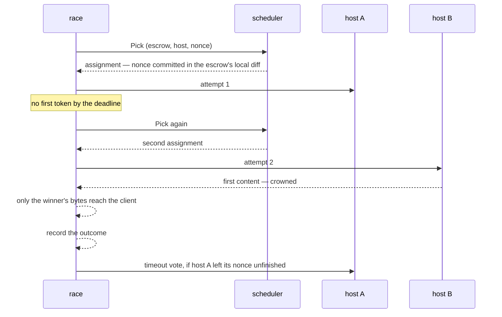

# The request path

One `POST /v1/chat/completions`, from the socket to the settled nonce. Every step names the file and function that does it.

## Order of operations

`api/routes.go`, `handleChat` → `chat` → `race`.

| # | Step | Where | Fails with |
| --- | --- | --- | --- |
| 1 | read the body, capped at 10 MiB | `readBody`, `chatIngestLimit` = `filters.MaxBodyBytes` | 413 |
| 2 | normalise the request | `filters.NormalizeRequest`, options from `filterOptions` | 400 |
| 3 | will it fit a host-bound body once encoded | inline in `chat`: `transport.PromptWireBytes` + `hostCatchUpReserveBytes` against `transport.MaxHostRequestBytes` | 413 |
| 4 | authorise the model for this caller | `authorizeModel` | 400 when the model is absent; 401 |
| 5 | is the model routable at all | `routableModel`, for a caller step 4 admitted | 503 when not ready or an offered model has nothing routable; 400 for a model nobody offers |
| 6 | do the prompt and `max_tokens` fit the model's context | `checkContext`: the prompt's byte bound, and the pinned tokenizer's count only when the bound does not fit, with the chat template's minimum and `max_tokens` against the context length | 400 `context_length_exceeded` |
| 7 | does the chain phase admit new work | `admission`, on `snapshots.Snapshot()` | 503, except a refusal that is proof-of-compute alone, which waits for step 8 |
| 8 | cache lookup | `cacheKeyFor` → `cache.get` | — (hit returns here); a miss behind a proof-of-compute refusal answers that 503 |
| 9 | count the prompt once when `DEVSHARD_STATS_TOKENIZER` is on, take an admission slot and token budget | `countPrompt`, then `limiter.AcquireForModel` | 429 |
| 10 | does the chain phase still admit new work | `admission` again, on a fresh snapshot: the limiter can hold a request for minutes, and a block that began meanwhile must not get a nonce | 503 |
| 11 | race it | `race` → `engine.Run` | see below |
| 12 | release the slot | `limiterSlot` (`api/limiter_slot.go`): `limiter.ReleaseForModel` once the handler has returned and the race has run `engine.Request.OnFinished` | — |

Steps 4–7 run **after** normalisation because the model name is only known once the body is parsed and the per-model profile applied.

The slot outlives the handler when the race does. A race whose client left, or whose winner finished while losers still stream, carries on in the background for up to `drain_timeout_seconds`, and the request keeps its slot and its input tokens until that race has reported. `max_concurrent_requests` and `max_input_tokens_in_flight` therefore bound the work the hosts are still doing, not only the clients still connected ([race.md](./race.md), "Client departure and the drain").

## Step 2 in detail: `filters.NormalizeRequest`

`filters/pipeline.go`, `runPipeline`, in this order:

1. `unwrapExtraBody` — hoist `extra_body` into the top level.
2. `rejectUnknownParameters` — a parameter absent from the table is refused. The gateway does not forward what it has not been taught.
3. `applyStage(StagePreValidation)` — type and range checks, strips; then `validateStopTokenIDs` against the model's vocabulary.
4. `normalizeMessages` → `validateMessages` — message hygiene, separate because a message is a nested document.
5. `decodeRequestView` — the typed view of what the client asked for.
6. `applyOutputTokenLimits` — default and cap, per model.
7. `decodeLogprobIntent` — **read here, before the next stage**, because `StagePostLimits` caps `top_logprobs` and afterwards the document says the width that goes on the wire, not the one the client asked for.
8. `applyStage(StagePostLimits)` — the forcing stage: `top_logprobs` capped at 5, `n → 1` when present, and each model profile's own forces ([`filters/README.md`](../filters/README.md), "Model profiles"); then `syncRequestView` re-decodes the view and `decodeUsageIntent` reads the client's `include_usage`.
9. `forceUpstreamStreaming` — unless `force_upstream_streaming` is off.
10. `document.Marshal` → `Result`.

`Result` carries the normalised body plus what the **client** asked for: `ClientStream`, `ClientUsage`, `Logprobs`, `MaxTokens`. The body and the intent diverge, and that divergence is the whole response side.

### The rule table

`filters/table.go` is one row per top-level parameter: name, stage, rule. Per-model divergences live in `filters/presets/<name>.json`; an operator binds a model to a preset, or sets knobs over its own, through `/v1/admin/filters` ([`filters/README.md`](../filters/README.md), "Model profiles").

| Forced regardless of the client | Why |
| --- | --- |
| `n: 1` when present | reservation budgets one `max_tokens` output; `n` choices can produce `n` times what was signed for |
| `stream: true` | the gateway needs the stream to time the first token and spot a stall |

The executor forces `logprobs` and `top_logprobs` itself, and `return_token_ids: true` beside them (`common/completionapi.ModifyRequestBodyWithLogprobsMode`), so the gateway carries the client's `logprobs` and `top_logprobs` as asked, `top_logprobs` capped at `completionapi.ForcedTopLogprobs` (5), rather than forcing them ([`filters/README.md`](../filters/README.md), "Parameter rules"). `return_token_ids` is the executor's alone: the gateway strips it from the client's request.

## Step 6 in detail: the context check

A host refuses a request whose prompt and `max_tokens` together exceed its `--max-model-len`, and it refuses it after the nonce is committed, so the escrow pays for an attempt no host could serve. Step 6 refuses it first, with OpenAI's `invalid_request_error` / `context_length_exceeded`, when

```
prompt tokens + chatTemplateMinimumTokens + max_tokens > context length
```

Each term on the left is meant as the least the host counts for it, so the check refuses only a request a host refuses: exactly so up to 64 KiB of prompt text, and past it as far as the sampled count's worst measured over-count reaches.

- **What a host does.** Hosts run the gonka-ai vLLM fork at `release/v0.25.1`, the base of the ML node image. A chat request's tokenization limits are `max_model_len` and the request's `max_completion_tokens`, else its `max_tokens` ([`chat_completion/protocol.py` L552-L570](https://github.com/gonka-ai/vllm/blob/aaaba178f96b676d697d65ccf67cbc64ad247723/vllm/entrypoints/openai/chat_completion/protocol.py#L552-L570)). A rendered prompt longer than `max_model_len` less that number is refused with "This model's maximum context length is …" ([`renderers/params.py` L427-L452](https://github.com/gonka-ai/vllm/blob/aaaba178f96b676d697d65ccf67cbc64ad247723/vllm/renderers/params.py#L427-L452)). vLLM shortens `max_tokens` to the room the prompt leaves only for a request that names none ([`serve/utils/api_utils.py` L170-L206](https://github.com/gonka-ai/vllm/blob/aaaba178f96b676d697d65ccf67cbc64ad247723/vllm/entrypoints/serve/utils/api_utils.py#L170-L206)), and no request reaches a host without one, because step 2 writes it into every body.
- **`max_tokens`** is `filters.Result.MaxTokens`, the number step 2 sends: the client's `max_tokens` or `max_completion_tokens`, the smaller of the two when both are sent, within the cap, or the default when neither is ([`filters/README.md`](../filters/README.md), "Output token limits"). A request without `max_tokens` is checked against the default, as the host checks it.
- **The context length** is `config.Limits.ContextLength`: the `--max-model-len` governance registers, else the operator's `max_model_len` pin. A model with neither is not checked; `fallback_max_model_len` is a price, not a length, and is never checked against.
- **The byte bound first.** `Counter.MaximumTokens` bounds the prompt's tokens from its bytes alone, so a prompt whose bound, the template allowance and `max_tokens` fit the context is served without tokenizing it here. Only a prompt the bound does not clear is tokenized, and that count is the request's one count ("The prompt token count" below).
- **The prompt tokens** are that count's `Minimum`, from the [`tokenizer`](../tokenizer/) the epoch pins for the model, over `filters.PromptText` of the normalized body: the text the chat template renders, without the template ([`filters/README.md`](../filters/README.md), "The prompt text"); `app/prompt_tokens.go` joins the two. Up to 64 KiB the count is exact. Beyond, it is the sampled estimate less its worst measured over-count, a lower bound on every comparison text; a prompt whose dense stretch the samples land in can over-count by more, and is refused only when it comes within that excess of the context ([`tokenizer/README.md`](../tokenizer/README.md), "Estimating a long prompt").
- **`chatTemplateMinimumTokens`** (4) is the fewest tokens a pinned chat template adds to a request: DeepSeek-V4-Flash's one-message prompt adds `<｜begin▁of▁sentence｜>`, `<｜User｜>`, `<｜Assistant｜>` and its thinking marker. The other templates add more: GLM-5.3-Flash 12 to 21 tokens and MiniMax-M2.7 16 to 38 on one to six messages, and every pinned template 112 to 274 once a tool is defined. What the allowance leaves out leaves a request unchecked, never refused.
- **The refusal** names the context length, `max_tokens`, the prompt tokens and their total, and the ways out: shorten the messages by the excess, or lower `max_tokens` to the room the prompt leaves when that is at least one token.
- **Fail open.** A model without a tokenizer the gateway reads, a tokenizer still loading, a pin or a body that cannot be read: the request goes on unchecked, which is how it went before the check existed.
- **Placement.** The check runs after authorisation and routability, because it needs a served model's context length; before admission, the cache, the limiter and the race, so a refused prompt takes no slot and no nonce. It is not captured, like step 3's refusal, and the route's status series counts it.

### The prompt token count

The request's prompt tokens are counted at most once, and the request carries the number and its source (`filters.InputTokensSource`) from there on. Which requests are counted is set by `DEVSHARD_STATS_TOKENIZER`, off by default ([`operations.md`](operations.md)):

- **Off.** Only the context check tokenizes, when the byte bound made it, and that count is the request's. Every other request carries the byte estimate, marked `bytes_estimate`: step 9 neither tokenizes nor consults the gate below, and a model without a context length is not read for its tokenizer.
- **On.** The count is the context check's when the byte bound made it tokenize; otherwise `countPrompt` takes it at step 9, after admission and the cache lookup, so a request admission refuses or the cache answers is never tokenized. Step 9's count merges at most 512 bytes of any one pre-token and estimates a longer one from its start, so an unsplittable run costs about what the same bytes of prose do ([`tokenizer/README.md`](../tokenizer/README.md), "Capping a piece's merge"); a request counted that way carries `tokenizer_sampled`. The context check's count is never capped, so who the check refuses does not depend on the setting.

In either mode a cache hit's `request finished` line carries the count so far: the context check's, else the byte estimate marked `bytes_estimate`.

At most `DEVSHARD_MAX_CONCURRENT_PROMPT_COUNTS` counts run at step 9 at once, half the processors by default. The gate never waits: a request that finds it full carries the byte estimate, marked `bytes_estimate`, so step 9's counts take at most that many processors and the rest of the gateway keeps its own; `devshard_gateway_prompt_count_gate_full_total` counts those requests by model. The context check's count does not pass the gate, because a prompt that may not fit must be counted to be refused. The client decides when that count runs, with a prompt long enough or a `max_tokens` large enough that the byte bound misses the context, and it runs before admission, so the gate does not bound it.

| Source | When | Tokens |
| --- | --- | --- |
| `tokenizer_exact` | the model's pinned tokenizer is loaded and the prompt text is at most 64 KiB | `Counter.EstimateTokens` of `filters.PromptText`, exact |
| `tokenizer_sampled` | the same past 64 KiB, or a step 9 count of a prompt with a pre-token past 512 bytes | the sampled or capped estimate; the check reads the sampled estimate's `Minimum` instead |
| `bytes_estimate` | no tokenizer for the model, one still loading, a body or count that fails, the stats tokenizer off for a prompt the context check did not tokenize, a full prompt count gate, or a cache hit the context check did not count | `filters.EstimatedPromptTokens` of the normalized body's length |

The check reads the count's `Minimum`; the gateway limiter's in-flight input tokens and `max_input_tokens_in_flight`, `engine.Request.InputTokens` (the participant windows and the prefill-per-token histogram), the request ledger's `estimated_input_tokens` and the nonce ledger's `estimated_input_tokens` and `estimated_error_tokens` read the count itself. The tokenizer counts the messages without the chat template, so the count stays below the host's `prompt_tokens` by the template's tokens. The chain charges bytes, so the escrow reserve (`InputBytes`), the liquidity forecast and `RetirementReserve` keep the body's length and never read this count. The first-token and receipt deadlines, the fleet's first-token curve and the context-refusal checks were fitted on the byte estimate, so they read `engine.Request.InputTokensFromBytes`, the byte estimate the request also carries, whatever the count's source.

In both modes a request counted with the model's tokenizer is charged in tokenizer tokens and any other request in the byte estimate; with the stats tokenizer off, only prompts the context check had to tokenize (their byte bound plus `max_tokens` may not fit the context) carry tokenizer tokens. The limits denominated in input tokens read each request in its own count's unit: English prose counts about two thirds of its byte estimate, a short request a fraction of it, and Cyrillic or CJK text can count more than it, so the same `max_input_tokens_in_flight` admits more English and less Cyrillic or CJK counted by the tokenizer than counted by bytes. With the stats tokenizer on, a model switches from bytes to tokens when its tokenizer loads or its pin moves, and back to bytes while the gate is full. Either way the limiter's windows and the prefill-per-token histogram mix the two units. A request costs at most one tokenization; past 64 KiB the sampled count bounds that cost whatever the prompt's length ([`tokenizer/README.md`](../tokenizer/README.md), "Bounds").

## Step 11 in detail: the race

`api/routes.go`, `race` → `engine.Run` (`engine/engine.go`).



The escalation ladder (`engine/escalation.go`) times each stage — receipt, first token, inter-chunk silence — against a configured deadline; the first token's grows with the prompt and is extended, never shortened, by the host's own first-content p75 ([race.md](./race.md), "Escalation"). `MaxAttemptsPerRequest` bounds the **unfinished** attempts a race holds at once, the primary included: an attempt that ends gives its place back, and the race starts no more attempts in total than its host group has.

## The response side

Two shapes, decided by what the client asked for, not by what the host sends — the host always streams.

**Streaming client** — `filters.StreamRewriter` (`filters/stream.go`): each event is parsed, stripped, and forwarded as it arrives. A partial event is held in a carry bounded by `MaxStreamCarryBytes` (32 MiB).

**Non-streaming client** — `filters.BodyFolder` (`filters/fold.go`): events are folded into the answer **as they arrive**, and the internal fields are removed *before* merging. What the request holds is the answer being assembled, not the stream it came from. `api/stream.go`'s `Close` then chooses the status from the assembled body — a body the assembler could not fold is answered 502, never 200 with an error object inside.

### What a client can and cannot see

`filters/response.go`:

| Field | Returned? |
| --- | --- |
| `logprob`, `logprobs`, `top_logprobs` | only if the client asked (`logprobs: true`) |
| `token_ids`, `prompt_token_ids`, `prompt_logprobs` | never |

The "always stripped" list is **derived** from the two above, not written out a second time — a second hand-written list can omit a field the first strips, which leaks `top_logprobs`.

## Memory

| Bound | Value | What it bounds |
| --- | --- | --- |
| `chatIngestLimit` | 10 MiB | one request body as it arrives |
| `transport.MaxHostRequestBytes` | 10 MiB | one request body as a host receives it |
| `hostCatchUpReserveBytes` | 1 MiB | the room inside that body kept for the escrow's catch-up |
| `MaxStreamCarryBytes` | 32 MiB | one unterminated SSE event |
| `maxBufferedResponseBytes` | 32 MiB | one reply being assembled |
| `max_buffered_response_bytes` | 512 MiB | **every** reply being assembled, and every reply being recorded for the response cache, at once; a recording the budget cannot hold stops and that reply is not cached, while the client still receives it whole. Recordings and assemblies spend the one budget, so a non-streamed reply that is also recorded is counted twice while both copies are held, and an assembly refused while recordings fill the budget is answered 503 like any other |

The two 10 MiB bounds are not the same bound. A prompt travels as raw bytes in its own field of the protobuf envelope (`transport/envelope.go`, `MarshalWrappedInferenceRequest`), so it costs its own length plus a few bytes of framing, while the catch-up diffs ride the JSON document beside it as `DiffJSON` with every byte field base64 (`transport/request_size.go`, `PromptWireBytes` and `diffWireBytes`). A request inside the ingest cap can therefore be past what the public proxy, the versiond router and a host accept — the shape [issue #1658](https://github.com/gonka-ai/gonka/issues/1658) reported. Step 3 refuses it before a nonce is spent. When the catch-up backlog is what would not fit, it is drained ahead of the request instead of riding it ([`user/session.go`](../../../user/session.go), `drainOversizedBacklog`), and each drained chunk is cut by wire bytes rather than by diff count — a chunk a host refuses whole leaves its sync cursor where it was, so the next attempt rebuilds the same backlog, which is the loop [issue #1660](https://github.com/gonka-ai/gonka/issues/1660) describes. Only a body that still does not fit is refused at the send with `transport.ErrHostRequestTooLarge`.

**A session keeps only the newest diffs in memory.** A session with a store holds at most the newest 256 diffs (`maxRetainedDiffs`), and fewer once every host has acknowledged past them; the rest stay in the escrow's store (`user/session.go`, `dropDiffPrefixLocked`). A request carries at most one 200-diff chunk of catch-up (`catchUpChunkSize`). A host further behind than that — one far behind, one rewound to nonce 0 after it lost the escrow, or one left behind across a restart — is first taught every earlier nonce through chunked catch-up, whose store reads, in pages of at most 64 nonces or 8 MiB (`storage.ReadDiffPages`), are made without the session's lock so the escrow's other hosts are not held (`diffRange`). Only then does the request go out, carrying its own chunk. The inference, heartbeat, pending-diff and finalize paths and a timeout vote all go through it (`user/catch_up_send.go`, `catchUpForSend`), so no host-bound body is sized by how far a host lags. A store read that fails sends nothing: the request fails, `read trimmed diffs from store` names the range, the cursor stays where it was, and the next request to that host tries again. The store reads made under the lock are bounded: a catch-up within one chunk, and the post-state root of a nonce memory no longer holds, when a response reports one (`postStateRootForNonce`).

**Step 3 reserves room for the catch-up rather than measuring the prompt alone.** The diffs are the gateway's own state and a client cannot be refused for them, so the check asks whether the prompt fits inside `MaxHostRequestBytes` *less* `hostCatchUpReserveBytes`. Measuring the prompt against the whole budget admits a body that leaves nothing for the backlog, and the refusal then lands at the send — after the nonce is committed, which spends the escrow's reserve on nobody, and the exemption ladder is what keeps it off the host's record ([race.md](./race.md), "The exemption ladder"). The reserve is a trade, and the numbers are worth stating: the prompt ceiling falls from about 10.48 MB to about 9.44 MB, which covers an ordinary backlog of a few thousand small diffs, while closing the hazard outright would mean reserving the full 4 MiB a backlog may ride inline and giving up roughly 40% of the usable prompt. What is left over is refused as the gateway's own limit rather than charged to a host.

The last one exists because the request limiter does not stand in for it: by default `max_concurrent_requests` admits 2 048 requests per model at a time, and at 0 the cap comes from network weight alone. Past it, a request is refused 503; `devshard_gateway_buffered_response_bytes` is what is held right now.

## Compression to the host

A chat request is gzipped only from 4 KiB up (`app.chatCompressMinBytes`, carried to the transport as `transport.ClientConfig.ChatCompressMinBytes`). A typical request, prompt and catch-up together, is 1–3 KiB, where gzip saves about 1 KiB on the wire but costs about 28 µs and a fresh 814 KB `flate` writer: Connect pools its compressors in a `sync.Pool`, which garbage collection drains, so under load most messages build the writer again. Below the threshold the request goes out as it is, which the host's Connect handler accepts like any other; above it a long prompt or a large backlog is still compressed. Clients that leave the field at zero, hosts among them, gzip every request.

## Where to change what

| To change | Go to |
| --- | --- |
| a parameter's validation or default | `filters/table.go`, and `filters/rules_*.go` for the rule body |
| how one model differs | `filters/presets/<name>.json` |
| what a client may see back | `filters/response.go`, `clientStrippedFields` / `requestableFields` |
| the status a failure gets | `api/errors.go`, `statusForError` |
| when a second attempt starts | `engine/escalation.go` |
| which escrow is picked | `scheduler/scheduler.go` |
| what a cache entry keys on | `api/cache.go`, `cacheKeyFor` |
