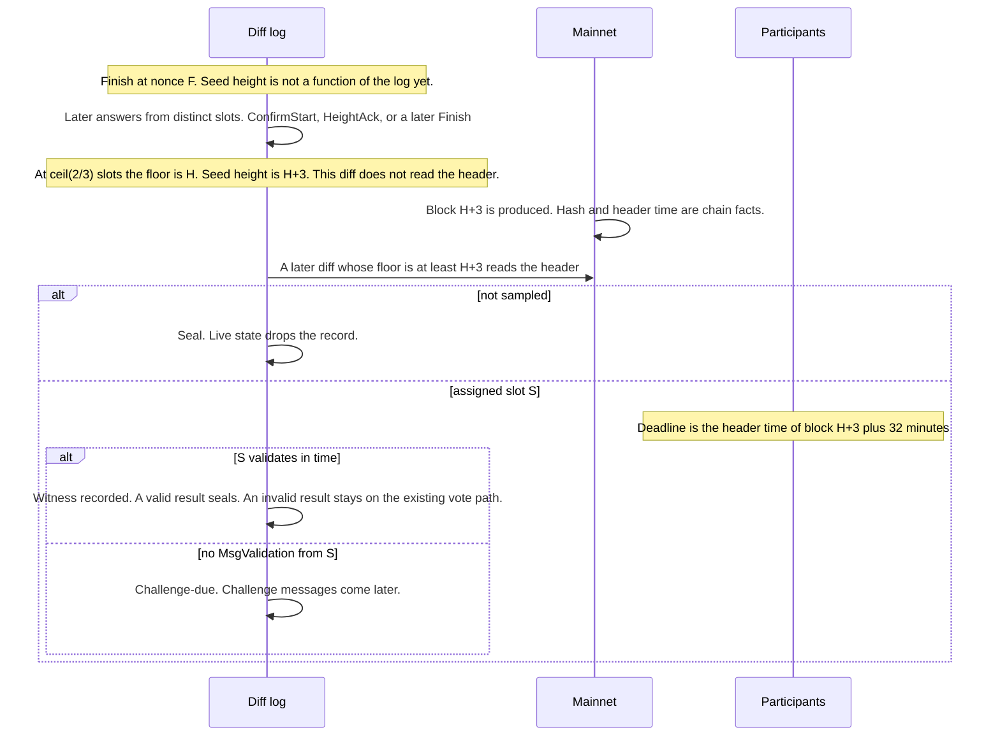

# Public validation assignment

Implementation plan. Each step lands on its own, with the tests named in that step green, before the next step starts. The challenge protocol is a later document. This plan stops at the moment the network is allowed to open one.

Related design notes: [proposals/VALIDATION_PROTOCOL_PROPOSAL.md](./proposals/VALIDATION_PROTOCOL_PROPOSAL.md), [inference-lifecycle.md](./inference-lifecycle.md) (seal triggers), [proposals/HEIGHT_SYNC_PROTOCOL_PROPOSAL.md](./proposals/HEIGHT_SYNC_PROTOCOL_PROPOSAL.md) (floor and heartbeats). This plan is the protocol to build. It does not use the three-party `MsgFinishInferenceCommit` sketch in the validation proposal.

## What is wrong today

`MsgFinishInference` commits the executor's response hash. After that, every host decides for itself whether it should validate, with `state.ShouldValidate` and a seed derived from its own signature over the escrow (`host.ownSeed` in `devshard/host/host.go`, `DeriveSeed` / `ShouldValidate` in `devshard/state/validation.go`). No other participant can recompute that decision. A validation message is accepted from any non-executor slot (`applyValidation` in `devshard/state/machine.go`).

A finished inference that nobody validates stays in the live map until the grace seal fires: `InferenceSealGraceNonces` (default `10 * len(group)`, floor 20) and `InferenceSealGraceSeconds` (default one hour) both have to pass (`autoSealLocked` in `devshard/state/seal.go`). That grace exists because the outcome is still formally open. It is also why a long session keeps every finished record in RAM and in the state root.

## Protocol

1. **A confirm raises the floor under the same checks as a finish.** Today `confirmStartLocked` copies `StartStamp` into the receipt, and `checkStartStamp` rejects anything else, so a confirm repeats a floor the log already has and `FloorIndex.Observe` does not move. On the new version the confirm carries the executor's height the way `RunExecution` stamps a finish: the response-leg envelope of that hop when it is present (`FinishObserved`), otherwise the oracle tip, then `referenceStamp` so the result is `max(tip, F(inference_id))`. The height stays inside `ExecutorReceiptContent`, so `executor_sig` covers it the way `proposer_sig` covers a finish. L0 requires the height to be at least `F(inference_id)`. L0b still requires `confirm ≤ finish` when both messages are in the same diff (`checkL0b` compares that pair only inside one diff). A retried confirm returns the receipt already queued, so it keeps the first hop's stamp. `FilterHostRaises` omits that copy on a later hop until the floor catches up, and that delay is accepted. `FilterHostRaises` already drops a confirm raise whose height is not this hop's envelope, and drops such a finish the same way. `floorClaims` already attributes the confirm to the executor slot, so a height above the current floor raises it, and `checkRaiseResolvableLocked` waits for that header. v6 keeps `checkStartStamp`. The start stamp stays exactly the floor at its nonce, and `ConfirmedAtTimeMs` stays the floor at the nonce where the receipt lands.

Two further facts become known at different times.

2. **The seed height is the floor once a quorum of post-finish answers is in the log.** An answer is a `MsgConfirmStart`, a `MsgHeightAck`, or a `MsgFinishInference` tied to a start or heartbeat nonce greater than `FinishNonce`. There is no fixed span of `slots_num` nonces and no `F+5` wait. A diff that carries no such answer does not consume a slot. `PinHeight` is the floor at the diff where `QuorumForRoster` distinct slots have an answer included, `ceil(2/3 × slots)`. A host that never answers does not block it. The finish's own height is not the pin: that message sits at `FinishNonce`, so it is not an answer. At the finish the number does not exist yet, so the executor cannot compute it from the finish message.
3. **The seed is the block hash at that height plus three.** Three blocks after the pinned height, the hash is a chain fact. The assignment is a pure function of that hash, the escrow, the inference id, the group, and `ValidationRate`. Every participant who has the diff and that block computes the same answer. The proposer of that one block can grind the hash. That is a [known limitation](#known-limitation-seed-block-proposer), fixed in a later change, and this plan does not mitigate it.

The answer has two parts, in this order:

- **Should this inference be validated at all?** One draw against `ValidationRate`. `10000` is "always", `0` is "never", `5000` is half of inferences. This is one decision per inference. It replaces the current per-host draw, where the rate is spread across validators.
- **If yes, which single slot validates?** One slot whose address is not the executor's address. Every slot of the executor's address is excluded, including sibling slots of the same operator.

If the draw says no, the inference is sealed on the first diff that reads a resolved header at `SeedHeight`. That read waits until the floor is at least `SeedHeight`. The live map and the live part of the state root lose the record. The sealed snapshot keeps it. Payload bytes stay until the epoch partition drop, as they do today. A `MsgErrorMiss` can still land after that seal. The miss needs a `StatusFinished` record (`applyErrorMiss`), and the seal would otherwise reject it and fail the diff. On the new version that miss runs against the sealed snapshot and moves it to `StatusTimedOut`, with the same balance and `Missed` updates as a live miss. A miss for a record sealed for any other reason still fails.

If the draw names a slot, that slot is the only one whose `MsgValidation` counts while the record is `StatusFinished`. The network then waits **32 minutes** of chain time, measured from the header time of the seed block. A `MsgValidation` from the assigned slot in that window is the witness. When the window ends with no such message, the record is marked challenge-due. Opening the challenge, the evidence, and the votes are specified later. This plan does not send them, and it does not reuse today's `StatusChallenged` path for a missing witness. `StatusChallenged` today means a validator already reported the output invalid and a vote is in progress (`applyValidation` when `Valid` is false).



### Constants

| Name | Value | Role |
| --- | --- | --- |
| `ValidationSeedOffsetBlocks` | 3 | Blocks added to the pinned floor height to get the seed height |
| `ValidationWitnessWindow` | 32 minutes | Chain time after the seed block's header time, before a missing witness is challenge-due |

They are protocol constants of the new version, compiled in, same for every replica. They are not escrow params and not env vars. A test may pass a shorter window only by constructing the state machine with an explicit override; production code uses the table.

### Where the height comes from

The floor (`heightsync.FloorIndex`, read as `StateMachine.HeightSyncFloorAsOf`) is the highest host-signed chain height in the log. On the new version a confirm, a finish, and a height ack raise it. A user-signed `MsgHeartbeat` or `MsgStartInference` does not (`FloorIndex.Observe` skips `SequencerSigner`). v6 confirms repeat the start stamp and do not raise it.

`PinHeight` is that floor at the first diff where `QuorumForRoster` distinct slots have a post-finish answer included (`devshard/heightsync/quorum.go`, `ceil(2/3 × slots)`, the same count a heartbeat turn uses). An answer is a `MsgConfirmStart`, a `MsgHeightAck`, or a `MsgFinishInference` on a start or heartbeat nonce greater than `FinishNonce`. Each carries the host's height. A diff with no such answer does not consume a slot, so a finish-only diff, an error miss, a timeout, or a quiet-settle compose cannot make an honest roster miss quorum. `SeedHeight = PinHeight + 3`. The finish under assignment sits at `FinishNonce` and is not an answer. Fewer than two thirds leaves `SeedHeight` unset. A slot that never answers is the third the quorum does not require.

**The heartbeat loop must be on for the new version.** `DEVSHARD_HEIGHTSYNC_HEARTBEAT` stays the v6 switch and defaults off. The new version does not consult it: `StartHeartbeatLoop` runs, and `DisableHeightSyncHeartbeat` is false. After the first finish has seeded the floor, the height-sync rule applies. Inference traffic counts as a turnover. A quiet stretch longer than `DefaultHeartbeatInterval` opens the next turn, and those turns continue for the life of the active session. That is what moves the floor to `SeedHeight`, brings the assigned host's `MsgValidation` back with the ack round, and gives `ChallengeDue` a diff to land in. `FeePerNonce` on those nonces (`applyCoreJournaled`) and the `heartbeatAt` growth are accepted ([heartbeat-index-cap.md](./proposals/heartbeat-index-cap.md)).

A busy session already has the answers: later inferences produce the confirms and finishes, and the cadence stays quiet while that traffic is a turnover. The floor is the highest host stamp in the log when the quorum diff is applied. A stamp signed before the finish is not an answer. The choices that remain are in [Known limitation: user-chosen pin](#known-limitation-user-chosen-pin).

The pin, the header read, and `ChallengeDue` run in `PhaseActive` and `PhaseFinalizing`. They stop at settlement. `drainLiveIntoSealedAccLocked` still seals whatever is live on the way into `PhaseSettlement`.

The three walks use queues, not the live map. `applyFinishInference` appends the id to the pin queue. The id leaves that queue when `SeedHeight` is set, or when the record leaves `StatusFinished` (timeout, error miss, seal). The header read walks the ids that have `SeedHeight` and an empty `SeedHash`, and only when the floor is at least `SeedHeight`. `ChallengeDue` walks the ids that have `AssignedSlot`. Restore rebuilds the three queues from the live map once. A diff does not scan every live inference.

### Where the hash comes from

`ApplyDiff` is a pure function of the log plus chain headers honest replicas agree on. Once the pin rules hold, the log already names `SeedHeight`. The hash is the header the chain has at that height. Apply reads it from the header source. No transaction carries it, and `MsgValidation` stays a witness from the assigned slot.

On the new version, after the floor is folded and the pin has run, the unresolved queue (a `SeedHeight` and an empty `SeedHash`) is resolved only when the floor is at least `SeedHeight`:

- Before that, the id stays on the queue and the diff commits. The quorum diff does not call `HeaderAt`. `SeedHeight` is the floor plus 3, so that header does not exist yet, and failing the diff would stall every pin for about three blocks.
- Once the floor is at least `SeedHeight`, a host-signed stamp at that height has already passed `checkRaiseResolvableLocked`, so the block exists. The header source is asked for the header at `SeedHeight` by height. Floor stamps still go through `HeaderTimeMs(height, hash)`, because those messages already carry a hash. This read has a height and wants the hash back. The state machine's header source grows `HeaderAt(height) (hash []byte, timeMs int64, err error)`. `ErrHeaderPending` means the oracle has no header there yet.
- Pending at that point fails the diff. The journal rolls it back, and the gateway retries. A replica that already has the block and one that does not therefore do not commit different hashes. The same wait is what a floor raise does in `checkRaiseResolvableLocked`.
- A resolved header stores `SeedHash`. The id leaves the unresolved queue. `HeaderAt` is not called again for it. `AssignValidator` runs on that hash in the same apply.
  - Not sampled: seal, through the same accumulator `autoSealLocked` uses.
  - Sampled: set `AssignedSlot`. `WitnessDeadlineMs` is that header's time plus 32 minutes.

Transactions in a diff are applied before this hook, the same place the pin runs (`observeHeightSync` is after `applyTx`). A `MsgValidation` in the diff that first stores `AssignedSlot` is rejected. The next diff accepts one from that slot. The read runs on the first applied diff whose floor is at least `SeedHeight`. Leaving a transaction out of an earlier diff does not keep the slot unset, and it does not fail that earlier diff.

### Clock for the 32 minutes

The window starts at the header time of block `SeedHeight`. `WitnessDeadlineMs` is that time plus `ValidationWitnessWindow`, stored when the header is first read. A later diff whose floor header time is at or past the deadline, and whose record still has no `MsgValidation` from the assigned slot, sets `ChallengeDue`. The deadline does not move if that later diff is delayed. A resolving diff whose floor is already past the deadline sets `ChallengeDue` in the same apply. No wall clock is read. Tests move the header-time source forward. They do not sleep.

`ChallengeDue` is a field on the live record. The hook that sets it walks the assigned queue only. Status stays `StatusFinished`. When the nonce gate is still closed the record stays in the live map. When it is open, `autoSealLocked` folds it in the same apply. The owed set does not grow to the whole group. The bit stays in state because that fold has to keep it. A pure check at challenge time would miss a record that has already left the live map.

### Grace seal

`sealEligibleStatus` includes `StatusFinished`, and `autoSealLocked` seals a finished record when both gates pass (`devshard/state/seal.go`). The nonce gate is `sealNonce >= id + InferenceSealGraceNonces`. The clock gate is `stateClock - ConfirmedAtTimeMs >= InferenceSealGraceSeconds + ExecutionTimeout`. `ConfirmedAtTimeMs` is ConfirmStart. `ExecutionTimeout` is the inference timeout, 32 minutes in `DefaultSessionConfig` (`32 * 60`). That sum leaves `InferenceSealGraceSeconds` after the latest legal finish. The default extra grace is one hour (`DefaultInferenceSealGraceSeconds` = 3600). Governance can set it shorter, including under 32 minutes.

The witness window runs from the seed block's header time, while today's clock gate runs from `ConfirmedAtTimeMs`. A pin that lands late leaves the deadline after the grace, the record seals while the window is still open, the assigned slot gets `ErrInferenceSealed`, and `ChallengeDue` was never written. Holding the quorum back is one way the pin lands late. That case is in [Known limitation: user-chosen pin](#known-limitation-user-chosen-pin).

On the new version the Finished grace is a state condition. The clock formula above is not lengthened.

- An assigned record is grace-eligible only after `ChallengeDue` is set or a witness has landed.
- A finished record with no `SeedHash` yet is not grace-eligible.
- The nonce gate is unchanged and can only hold an eligible record longer. The grace test advances the nonce past it, so the hold under test is the state condition.
- v6 keeps `InferenceSealGraceSeconds` as configured.

`ChallengeDue` is set from the floor header in the post-floor hook, and `autoSealLocked` runs later in the same apply. A diff that crosses the deadline writes the bit and then folds the record. The sealed entry is the new-version frame, so the snapshot keeps `challenge_due`. A `MsgValidation` with `Valid: true` seals in that apply and does not wait for grace. Unsampled records still seal on the resolving diff and do not wait for this grace. Settlement drain remains the upper bound for a record that never becomes grace-eligible.

### Version

`marshalInferenceEntry` (`devshard/state/hash.go`) hashes `InferenceRecordProto` with `deterministicMarshal`. The frozen comment in `state.proto` covers `HostStatsProto`, which the chain settlement hashes. The chain does not decode an inference record. It treats `rest_hash` as opaque. Existing inference field numbers stay. New fields start at 24:

| Field | Number | Notes |
| --- | --- | --- |
| `finish_nonce` | 24 | |
| `pin_nonce` | 25 | |
| `pin_height` | 26 | |
| `seed_height` | 27 | |
| `seed_hash` | 28 | |
| `assigned_slot` | 29 | `optional uint32`. Slot 0 is a real assignee, and a plain uint32 would omit it. Unset means no slot. |
| `witness_deadline_ms` | 30 | |
| `challenge_due` | 31 | |

proto3 encoding omits a field at its zero value, and omits an unset `optional`. A v6 record never sets these, so its bytes match today's `marshalInferenceEntry`. The new version sets the ones it has. There is no second framing and no `slot+1` encoding.

`assignsValidationPublicly(version)` is false for v6 and true for the new tag. Every behavior below is behind it. A v6 test that locks a state root stays green for the whole plan.

Sessions are not resumable across the cut. Mixed binaries in one group diverge on the root. That is the same rollout rule as the other state-root versions.

## Out of scope

- Challenge messages, evidence, votes, and slashing after `ChallengeDue`.
- Replacing logprob scoring, payload storage, or the shared validation scheduler. The scheduler keeps running whatever the owed set contains.
- A light-block proof of the seed. The header-time lookup is the check this version has. A proof can replace it when the height-sync strong path exists.
- User-paid "validate every inference". The rate is the only sample size here. `ValidationRate = 10000` is the always-on setting.
- Changing v6 sessions.
- The seed-block proposer grind, described under [Known limitation](#known-limitation-seed-block-proposer). This plan keeps a single block hash at `PinHeight + 3`.
- The user-chosen pin, described under [Known limitation](#known-limitation-user-chosen-pin). This plan pins from the floor once a quorum of post-finish answers is included. The heartbeat loop is on for that version.

## Step 1 — ConfirmStart raises the floor like a finish

**Code.** On the new version, as in [the first protocol point](#protocol):

- `confirmStartLocked` stops copying `StartStamp`. It stamps with `FinishObserved` of the response-leg envelope on that hop, otherwise the oracle tip, then `referenceStamp(inferenceID, ...)`.
- `checkStartStamp` is not applied. v6 still rejects a confirm that does not repeat the start pair.
- L0, L0b, `FilterHostRaises`, `floorClaims`, and `checkRaiseResolvableLocked` are already the finish checks. A confirm whose height is above the floor and whose header resolves raises `F`, authored by the executor slot. L0b rejects a finish below that confirm only when both are in the same diff.
- A retry of `confirmStartLocked` returns the queued receipt and keeps the first hop's stamp.
- `StartedAtHeight` and `ConfirmedAtTimeMs` keep their current anchors.

**Tests.**

| Test | Asserts |
| --- | --- |
| `TestConfirmRaise_HostTipRaises` in `devshard/state/` | New version. Start at floor `H`. Confirm carries `H+2` with a resolvable header. The floor becomes `H+2`. The floor author is the executor slot. `ConfirmedAtTimeMs` is the header time of the floor that stood at the landing nonce. |
| `TestConfirmRaise_BelowFloorRejected` | Confirm height under `F(inference_id)` is `INVALID(height_regression)`. Root unchanged. |
| `TestConfirmRaise_FinishBelowConfirmRejected` | Confirm and finish are in the same diff. Finish height under that confirm fails L0b. The same pair split across two diffs is not an L0b failure. |
| `TestConfirmRaise_PendingHeaderDoesNotRaise` | Header source returns `ErrHeaderPending` for the confirm's pair. The diff does not commit. Floor unchanged. |
| `TestConfirmRaise_SignatureCoversHeight` | Editing the height after `executor_sig` fails verification. |
| `TestConfirmRaise_V6RepeatsTheStart` | v6 confirm above the start stamp returns `ErrStampNotFloor`. Root unchanged. A confirm that repeats the start leaves the floor where it was. |
| `TestConfirmRaise_EnvelopeMismatchOmitted` in `devshard/heightsync/` | `FilterHostRaises` drops a confirm raise whose height is not this hop's envelope, and keeps one that matches, same as a finish. |
| `TestHost_ConfirmStampsTheEnvelope` in `devshard/host/` | Envelope height above the floor. The signed confirm carries that height and hash, not `StartedAtHeight`. |
| `TestHost_RetriedConfirmKeepsFirstStamp` | The same inference is confirmed again on a later hop with a higher envelope. The returned receipt is the first stamp. |

```bash
go test ./devshard/state/ ./devshard/host/ ./devshard/heightsync/ -count=1 -run 'TestConfirmRaise_|TestHost_ConfirmStampsTheEnvelope|TestHost_RetriedConfirmKeepsFirstStamp'
```

## Step 2 — Pure assignment

**Code.** `AssignValidator` next to `ShouldValidate` in `devshard/state/validation.go`.

```text
AssignValidator(seedHash, escrowID, inferenceID, group, executorSlot, rateBasisPoints)
    → (sampled bool, slot uint32)
```

Integer arithmetic only, same family as `uint64ProbabilityScale32`. Hash input is the domain string `devshard.assign.v1`, the escrow id, the inference id, and the seed hash. The digest is split. Bytes 0–7 are the sample draw. Bytes 8–15 pick the slot. One word must not do both, or the rate and the assignee move together.

- `rateBasisPoints == 0`, an empty hash, a group with no slot whose address differs from the executor, or the sample draw at or above the rate threshold: `sampled` is false. The slot word is not read.
- Otherwise `sampled` is true and `slot` is `eligible[slotWord % len(eligible)]`. `eligible` is every group slot whose address is not the executor's address, ordered by slot id.

No state machine, no proto, no host changes. v6 `ShouldValidate` stays as it is.

**Tests.** `devshard/state/validation_test.go`

| Test | Asserts |
| --- | --- |
| `TestAssignValidator_Deterministic` | Same inputs, same output, across two calls. |
| `TestAssignValidator_RateZeroNeverSamples` | Rate 0, including a non-zero hash. |
| `TestAssignValidator_RateFullSamplesWhenSomeoneElseExists` | Rate 10000 and a second address always samples. |
| `TestAssignValidator_ExcludesExecutorAddress` | The returned slot's address is never the executor's, even when the executor holds several slots. |
| `TestAssignValidator_SoloGroupNeverSamples` | One address in the group, rate 10000, `sampled` false. |
| `TestAssignValidator_SeedChangesAssignee` | Two hashes, rate 10000, a group of at least four distinct addresses: the test searches a handful of hashes and requires two different slots. The function is not asserted to change on every single bit. |
| `TestAssignValidator_Golden` | One fixed hash, escrow, id, and three-address group locked to a known slot. A comment records the digest inputs. |
| `TestAssignValidator_SlotUsesSecondWord` | Rate 10000. The slot equals `eligible[uint64(digest[8:16]) % len]`. The sample comparison reads `digest[0:8]` only. |

```bash
go test ./devshard/state/ -count=1 -run 'TestAssignValidator_'
```

## Step 3 — Pin the seed height from the floor

**Code.** On the new version only:

- `applyFinishInference` records `FinishNonce` and appends the id to the pin queue. The finish message's own `observed_height` is not the pin.
- After the floor is folded for a diff (`observeHeightSync` already runs inside apply), in `PhaseActive` and `PhaseFinalizing`, the hook walks that queue. When post-finish answers in [Where the height comes from](#where-the-height-comes-from) cover `QuorumForRoster` distinct slots, set `PinNonce`, `PinHeight` to the floor, and `SeedHeight = PinHeight + ValidationSeedOffsetBlocks`, and take the id off the queue. Below that count, leave it on. A diff that carries no answer does not consume a slot. An id that leaves `StatusFinished` before the pin comes off the queue and is not pinned later. The hook does not run in `PhaseSettlement`.
- The new fields are 24–27 on `InferenceRecordProto`. v6 leaves them unset, so the hashed bytes stay as they are today.

No seed hash, no seal change, no assignment yet.

**Tests.** `devshard/state/assignment_pin_test.go`, driving `ApplyDiff` with the header-time source from `header_time_test.go`.

| Test | Asserts |
| --- | --- |
| `TestPin_NotBeforeQuorum` | Answers after the finish come from one slot short of `ceil(2/3 × slots)`. Diffs with no answer sit in between. `SeedHeight` is still 0. |
| `TestPin_QuorumPinsTheFloor` | The answer that reaches `QuorumForRoster` distinct slots is included. `PinHeight` is the floor at that diff. `SeedHeight` is that plus 3. The finish under assignment is not `PinHeight`. One slot has no answer. |
| `TestPin_EmptyDiffDoesNotConsumeASlot` | A finish-only diff, an error miss, and a timeout follow the finish. They do not reduce the number of answering slots still required. |
| `TestPin_InferenceRoundNeedsNoHeartbeat` | The answers are later `MsgConfirmStart`s and there is no `MsgHeightAck`. At quorum, `SeedHeight` is set. |
| `TestPin_HeartbeatRoundCounts` | No later inference. A heartbeat turn after the finish supplies the answers. At quorum, `SeedHeight` is set. |
| `TestPin_ReplayAgrees` | A second machine applying the same diffs stores the same `SeedHeight` and the same state root. |
| `TestPin_V6LeavesFieldsUnset` | A v6 machine on the same diffs leaves the new fields zero and matches a root computed with `marshalInferenceEntry` as it is today. |
| `TestPin_SnapshotRoundTrip` | Save and restore on the new version. `FinishNonce` and `SeedHeight` come back, the pin queue matches, and the root matches. |
| `TestPin_ErrorMissLeavesTheQueue` | `MsgErrorMiss` lands before quorum. The id is off the pin queue. A later quorum does not set `SeedHeight`. |

```bash
go test ./devshard/state/ ./devshard/heightsync/ -count=1 -run 'TestConfirmRaise_|TestAssignValidator_|TestPin_'
```

## Step 4 — The heartbeat loop is on

**Code.** The heartbeat loop must be on for the new version. This is the height-sync cadence, not a turn opened while the pin queue is non-empty.

- v6 keeps today's switch. Unset `DEVSHARD_HEIGHTSYNC_HEARTBEAT` leaves `DisableHeightSyncHeartbeat` true, and `StartHeartbeatLoop` does not start the cadence goroutine.
- The new version does not consult that env. `DisableHeightSyncHeartbeat` is false and `StartHeartbeatLoop` runs. `MaybeHeartbeat` opens a turn when the session has been quiet for `DefaultHeartbeatInterval`, the same rule as height-sync §10.3. Inference traffic counts as a turnover, so a busy session does not open a span. Turns continue after the pin queue is empty, for the life of the active session. No new message type.
- `FeePerNonce` on those nonces and the `heartbeatAt` growth are accepted.

**Tests.**

| Test | Asserts |
| --- | --- |
| `TestQuietSession_HeartbeatPinsSeedHeight` in `devshard/user/` | New-version session, env unset, one finished inference, no further chat. The loop opens a turn, a fake chain advances, acks land, `SeedHeight` becomes non-zero. |
| `TestQuietSession_TurnsContinueAfterPin` | The pin queue is empty and no chat follows. The next interval opens another turn. |
| `TestQuietSession_BusySessionSkipsTheTurn` | Confirms after the finish already cover the roster. The gateway does not compose a heartbeat span. `SeedHeight` is set from those confirms. |
| `TestGateway_HeartbeatOnForNewVersion` in `devshard/cmd/devshardctl/` | Unset env. v6 leaves the loop disabled. The new version starts it. |

```bash
go test ./devshard/user/ ./devshard/cmd/devshardctl/ -count=1 -run 'TestQuietSession_|TestGateway_HeartbeatOnForNewVersion'
```

Step 3's package tests stay in the run for the state package when this step is touched.

## Step 5 — Read the seed block, then seal or name the slot

**Code.** On the new version, the apply hook after the pin does what [Where the hash comes from](#where-the-hash-comes-from) describes. It runs in `PhaseActive` and `PhaseFinalizing`, and not in `PhaseSettlement`. No new proto field and no host mempool entry.

- Floor under `SeedHeight`: the diff commits. `SeedHeight` may already be set. `SeedHash` stays empty. `HeaderAt` is not called.
- Floor at least `SeedHeight`, header pending: the diff returns `ErrHeaderPending` and the journal rolls it back. A pin computed in an earlier diff stays.
- Not sampled: seal on the resolving diff (`FoldSealedAccumulator`, drop the live record, write the sealed obs row). Status in the sealed snapshot stays `StatusFinished`. `InferenceSealGraceNonces` and the clock gate are not consulted. A later `MsgErrorMiss` for that id applies to the snapshot, as in the protocol section: `StatusTimedOut`, the reserved cost returned, `Missed` incremented. The diff is not rejected.
- Sampled: set `AssignedSlot` and `WitnessDeadlineMs` to the seed block's header time plus `ValidationWitnessWindow`. Move the id from the unresolved queue to the assigned queue. Leave the record live.

`ValidationRate` on the new version is the probability the inference is in the sample, in basis points. One assigned slot when it is.

Step 3's pin tests stop at the quorum diff. That diff sets `SeedHeight` and does not call `HeaderAt`. Step 4's pin test does the same. A later diff whose floor reaches `SeedHeight` is what resolves, and the seed tests install the header on that diff. v6 does not call `HeaderAt` and does not wait on it.

**Tests.** `devshard/state/assignment_seed_test.go`

| Test | Asserts |
| --- | --- |
| `TestSeed_PendingDiffDoesNotCommit` | The quorum diff has no header at `SeedHeight`. It commits. `SeedHeight` is set and `SeedHash` stays empty. A later diff whose floor is at least `SeedHeight`, with the header still pending, returns `ErrHeaderPending`. Root unchanged from that later diff. |
| `TestSeed_ResolvesHashFromTheHeader` | A later diff raises the floor to at least `SeedHeight` with the header installed. `SeedHash` equals that header. The diff contains no seed transaction. A second machine stores the same hash and the same root. |
| `TestSample_UnsampledSealsOnTheResolvingDiff` | Rate 0. After the resolving diff the id is absent from the live map, present in `LookupSealedInference`, and the root matches a second machine. |
| `TestSample_UnsampledDoesNotWaitForGrace` | `InferenceSealGraceNonces` is larger than the distance from finish to the resolving diff, and the state clock is nowhere near the grace. The record is still sealed. |
| `TestSample_SampledStaysLiveWithSlot` | Rate 10000, three addresses. `AssignedSlot` equals `AssignValidator`'s slot. `WitnessDeadlineMs` is the seed header time plus 32 minutes. The record is live. The executor's slots are not the assignee. |
| `TestSample_V6DoesNotResolve` | v6 machine, same diffs, header present. The new fields stay zero, the record stays live, and the root matches `marshalInferenceEntry` as it is today. |
| `TestSample_ErrorMissAfterUnsampledSeal` | Rate 0, seal on the resolving diff, then `MsgErrorMiss` in a later diff. The diff applies. The sealed snapshot is `StatusTimedOut`. Balance and `Missed` match a miss that ran while the record was live. A miss for an id sealed by grace or by a valid witness still fails. |

```bash
go test ./devshard/state/ ./devshard/heightsync/ -count=1 -run 'TestConfirmRaise_|TestAssignValidator_|TestPin_|TestSeed_|TestSample_'
```

## Step 6 — Only the assigned slot's validation counts

**Code.** On the new version:

- While status is `StatusFinished`, `applyValidation` rejects a `MsgValidation` unless `AssignedSlot` is set and `msg.ValidatorSlot` equals it. The existing signature, escrow, and `ErrSelfValidation` checks stay. A duplicate from that slot stays a no-op. The message does not carry a seed height or a block hash.
- Once status is `StatusChallenged`, that gate is off. `applyValidation` keeps today's branch: any non-executor slot's `MsgValidation` adds its address weight and `resolveChallengeTalliesLocked` still runs. The assigned-slot rule must not apply here, or the vote that an invalid result opens can never reach `VoteThreshold`.
- The hook that stores `AssignedSlot` runs after the transactions in that diff, so a `MsgValidation` carried there is rejected. The next diff accepts one from the assigned slot.
- A `MsgValidation` for an id that is already sealed is a no-op, including a second copy of the witness that sealed it. Today that path returns `ErrInferenceSealed` and fails the diff. A gossiped copy in a later diff would stall the session. A live `StatusFinished` record still rejects a slot other than `AssignedSlot`.
- The host owed predicate (`SetOwedValidationPredicate` in `devshard/state/owed.go`, installed by the host) is true only when `AssignedSlot` is one of this host's slots, the status is `StatusFinished`, and that slot has not yet validated. `ownSeed` and `ShouldValidate` are not read. A `StatusChallenged` record keeps today's rule that non-executor slots owe a vote.
- `collectValidationJobs` builds the job with `validatorSlot = AssignedSlot`. It uses `h.sortedSlots[0]` today, so a host that holds the assigned slot and another slot would sign the wrong one and be rejected. The signature is the assigned slot's key.
- After apply, the host drops every mempool `MsgValidation` for an id that is sealed or no longer owed. `RemoveIncluded` only drops the hash that was in the diff. A leftover entry ages out of `HasStaleEntry` (`host/staleness.go`) and the host withholds its state signature.
- A `MsgValidation` with `Valid: true` from the assigned slot seals on that diff. The sealed snapshot carries `ValidatedBy` and `VotesValid`.
- A `MsgValidation` with `Valid: false` still moves the record to `StatusChallenged` and stays live for the current vote threshold. It is not sealed here, and `ChallengeDue` is not set.

The shared pool keeps running whatever the owed set contains. No pool change.

**Tests.**

| Test | Asserts |
| --- | --- |
| `TestWitness_RejectsOtherSlot` | Header resolved, slot `S` assigned. A signed validation from another non-executor slot is rejected. Root unchanged. |
| `TestWitness_RejectsBeforeAssignment` | `SeedHeight` is set and the floor is still under it. A diff carrying a validation commits, the validation is rejected, and `SeedHash` stays empty. On the later diff whose floor reaches `SeedHeight`, a validation in that same diff is rejected and `AssignedSlot` is set. |
| `TestWitness_ValidSeals` | `Valid: true` from `S` on the following diff seals. `LookupSealedInference` shows `S` in `ValidatedBy`. Live map does not contain the id. |
| `TestWitness_InvalidStaysChallenged` | `Valid: false` from `S` sets `StatusChallenged`, leaves the record live, leaves `ChallengeDue` clear. |
| `TestWitness_ChallengedStillTakesOtherSlots` | After that invalid result, a `MsgValidation` from another non-executor slot applies and moves `VotesValid` or `VotesInvalid`. It is not rejected for failing the assigned-slot check. |
| `TestWitness_LateCopyIsNoop` | `Valid: true` from `S` seals. The same validation in the next diff applies, the root is unchanged, and the diff is not `ErrInferenceSealed`. |
| `TestOwed_OnlyAssignedHost` in `devshard/host/` | Three hosts. After the resolving diff, only the assigned host's owed set contains the id. The executor's does not. A host that shares the executor's address does not. The assigned host also holds another slot. The queued validation's `validator_slot` is the assigned slot, not `sortedSlots[0]`. A signature from the other slot is rejected. |
| `TestHost_DropsSealedValidation` | The host mempool holds a `MsgValidation` for the id. A diff seals the id without that tx. The entry is gone. `HasStaleEntry` is false. |

```bash
go test ./devshard/state/ ./devshard/host/ ./devshard/heightsync/ -count=1 -run 'TestConfirmRaise_|TestHost_ConfirmStampsTheEnvelope|TestHost_RetriedConfirmKeepsFirstStamp|TestHost_DropsSealedValidation|TestAssignValidator_|TestPin_|TestSeed_|TestSample_|TestWitness_|TestOwed_OnlyAssignedHost'
```

## Step 7 — 32 minutes, then challenge-due

**Code.** `WitnessDeadlineMs` is already the seed block's header time plus `ValidationWitnessWindow` (Step 5). On later applies, in `PhaseActive` and `PhaseFinalizing`, the hook walks the assigned queue. For an id still live, with a clear `ValidatedBy` for that slot, and a floor header time at or past the deadline, set `ChallengeDue`. Do not change status and do not add other slots to the owed set. A resolving diff whose floor is already past the deadline sets the bit in that same apply. This hook runs after the floor fold and before `autoSealLocked`. An id leaves the queue when it is sealed or leaves `StatusFinished`. The hook does not run in `PhaseSettlement`.

On the new version, `autoSealLocked` uses the state condition in [Grace seal](#grace-seal). Once `ChallengeDue` is set, a sampled finished record whose nonce gate has also passed seals in that apply, and the snapshot carries `challenge_due`. A record whose nonce gate is still closed stays live with the bit set. A finished record with no `SeedHash` yet is not grace-eligible. v6 uses `InferenceSealGraceSeconds` as configured.

A `MsgValidation` from the assigned slot after `ChallengeDue` still applies while the record is live (Step 6's rules). `ChallengeDue` stays set, so the later challenge design can see that the witness was late. A validation that already sealed the record cannot be undone by a floor that passes the deadline afterwards.

**Tests.** `devshard/state/assignment_witness_test.go`. The header-time source is set explicitly. Nothing sleeps for 32 minutes.

| Test | Asserts |
| --- | --- |
| `TestChallengeDue_NotBeforeTheWindow` | Floor time is one millisecond under the seed header time plus 32 minutes. `ChallengeDue` is false. |
| `TestChallengeDue_WhenTheFloorCrossesTheDeadline` | The nonce is past `InferenceSealGraceNonces`. The next host stamp resolves a header time at the deadline. The record seals. `LookupSealedInference` shows `ChallengeDue` and `StatusFinished`. |
| `TestChallengeDue_NonceGateHoldsAfterTheBit` | The nonce gate is still closed. The same crossing sets `ChallengeDue`, leaves the record live, and the owed predicate is still only the assigned slot. |
| `TestChallengeDue_AlreadyDueOnTheResolvingDiff` | The seed header is older than 32 minutes of floor time when it is first read. That diff sets `AssignedSlot` and `ChallengeDue`. With the nonce gate open, it seals in the same apply and the snapshot keeps the bit. |
| `TestChallengeDue_ClearedByAnEarlierWitness` | `Valid: true` from the assigned slot seals before the deadline. A later stamp past the deadline does not recreate a live challenge-due record. |
| `TestChallengeDue_InvalidValidationIsNotThisPath` | `Valid: false` inside the window yields `StatusChallenged` and `ChallengeDue` false. |
| `TestChallengeDue_UnsampledNeverWaits` | Rate 0. The resolving diff seals. No deadline is stored on a live record. |
| `TestChallengeDue_ReplayAgrees` | Two machines, same diffs, same header source, same deadline and same `ChallengeDue` bit, same root. |
| `TestGraceSeal_FloorHoldsASampledRecord` | The pin lands late. The nonce is past `InferenceSealGraceNonces`. `InferenceSealGraceSeconds` is 1 and `ExecutionTimeout` is 32 minutes. A state clock past confirm plus 96 minutes, with the floor still under the witness deadline, leaves the record live and `ChallengeDue` clear. When the floor crosses the deadline, the record seals and `LookupSealedInference` shows `ChallengeDue`. |
| `TestGraceSeal_V6UsesTheConfiguredGrace` | Same short grace on v6. A state clock past the configured grace plus the execution timeout seals the record. |

```bash
go test ./devshard/state/ ./devshard/host/ ./devshard/heightsync/ ./devshard/user/ ./devshard/cmd/devshardctl/ -count=1 -run 'TestConfirmRaise_|TestHost_ConfirmStampsTheEnvelope|TestHost_RetriedConfirmKeepsFirstStamp|TestHost_DropsSealedValidation|TestAssignValidator_|TestPin_|TestSeed_|TestSample_|TestWitness_|TestOwed_OnlyAssignedHost|TestQuietSession_|TestGateway_HeartbeatOnForNewVersion|TestChallengeDue_|TestGraceSeal_'
```

That run is the exit check for the plan. Step 7 is done when it passes and a v6 state-root test in `devshard/state/` (`TestComputeStateRoot` and the seal-root tests) still passes without a filter.

## Known limitation: seed-block proposer

The proposer of block `SeedHeight` can grind its hash. CometBFT chooses proposers in a known order, and that proposer chooses which transactions go into the block and in what order. Each attempt is a different block hash. `AssignValidator` is a pure function of that hash, so the proposer can keep trying until the draw says the inference is not sampled, or until it names a slot they prefer. An executor who is also that proposer can make "not sampled" the likely outcome.

The three-block offset does not close this. It means the hash is not fixed when the floor is pinned. The proposer of the later block still builds the block.

This plan does not change the seed to defend against it. No extra block hashes, no proposer exclusion, no test that a grind fails. The replacement is the group-commitment seed in [Known limitation: user-chosen pin](#known-limitation-user-chosen-pin). Until that lands, a sampled-or-not result is not safe against the proposer of `SeedHeight`.

## Known limitation: user-chosen pin

Post-finish answers close the menu of stamps signed before the finish. They do not close the user who builds the diffs.

Two choices remain.

- **Which two thirds.** Hosts sign a few blocks apart as answers arrive. The user waits until each `height + 3` is on mainnet, runs `AssignValidator`, and includes a subset of `QuorumForRoster` whose highest height is not sampled, or names a slot they prefer. The answers left out sit in the one third the quorum does not require. `PinHeight` is the floor on that diff, so the highest included answer becomes the seed. The floor is also the high-water of every host stamp already in the log, so a higher stamp that is not one of those answers becomes `PinHeight` when the user includes it in that diff.
- **Later answers.** If every two-thirds subset of the answers on hand is sampled, the user includes fewer than the quorum. `SeedHeight` stays unset. Later confirms, acks, and finishes are a new set of heights and a new draw. The first set is not binding, and a set that never reaches two thirds does not force the inference into the sample.

The complete design takes the validation-series seed from commitments the group publishes, instead of from a block hash at a height the user chooses when to reveal. Before the series is drawn, each participant commits to a value it has not opened. The seed is derived from the opened commitments, and `AssignValidator` runs on that seed for the inferences in the series. A party learns the draw only when enough openings are in the log to derive the seed. This plan does not add commit or open messages, and it does not define what a missing opening does. That rule is what keeps a withheld opening from becoming the later-answer redraw above.

## Residuals the challenge document inherits

- `ChallengeDue` with no messages defined for it. Settlement still seals leftover live records on the way into `PhaseSettlement` (`drainLiveIntoSealedAccLocked`). The pin, header-read, and `ChallengeDue` hooks have already stopped. Until the challenge document says otherwise, a challenge-due inference that reaches settlement is sealed there with the bit set in its snapshot and with no extra penalty. A `MsgFinalizeRound` before the answer quorum drains a finished record that was never pinned. `SeedHeight` is empty, nothing was sampled, and `ChallengeDue` is clear. That record is the same leftover: sealed at settlement, with no witness and no penalty.
- The heartbeat loop is what keeps a quiet session moving. A new-version gateway runs it. A gateway that does not produces no pin and no header read. While turns are applied, the read runs from the chain header once the floor reaches `SeedHeight`, and there is no seed transaction to drop.
- A pin taken from a host stamp that is more than three blocks behind the real tip makes `SeedHeight` a block that already exists. The offset only helps when the stamp is the tip. Heartbeat acks are how a quiet session keeps that stamp current. If that block's header time is already 32 minutes behind the floor, the resolving diff is born challenge-due. With the nonce gate open, that diff also seals it.
- Two honest oracles that disagree on the header at `SeedHeight` diverge on the resolving diff. The first resolved header is the one that sticks, because `HeaderAt` is not called again. Confirms already diverge when oracles disagree on `HeaderTimeMs` for the same `(height, hash)`.
