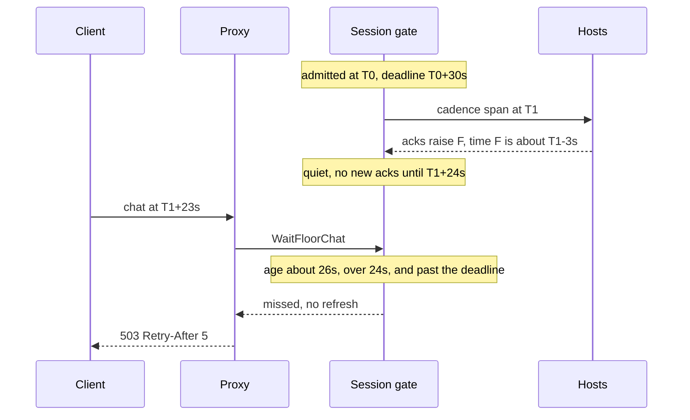
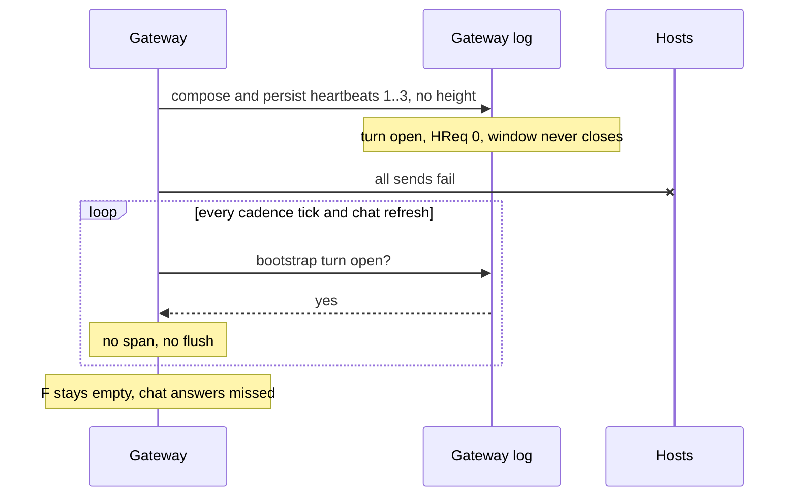
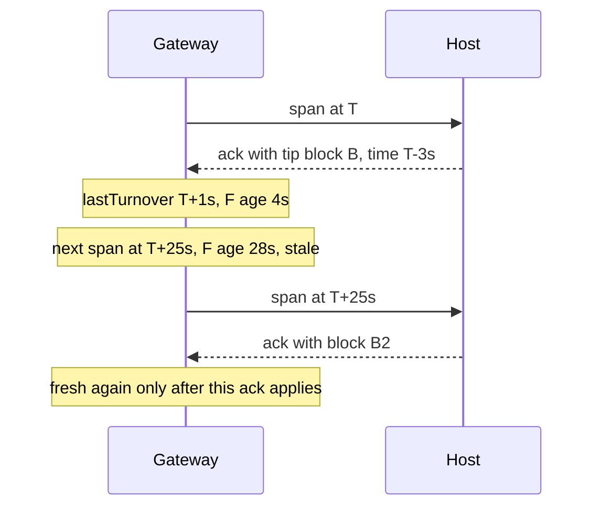
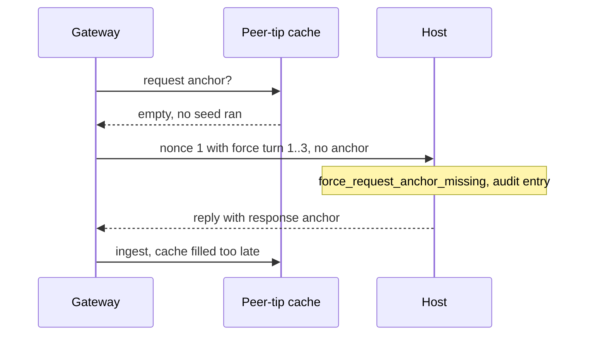
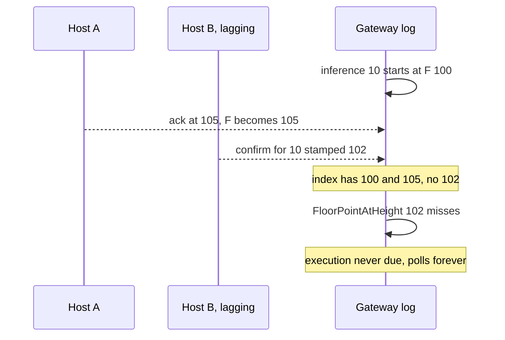

# Step 4 review: a floor before the first inference

**Plan:** [async-header-time-timeout-plan.md](async-header-time-timeout-plan.md) step 4
**Work reviewed:** [bootstrap-heartbeat-floor-plan.md](bootstrap-heartbeat-floor-plan.md), steps 1–7
**Status:** Review. Issues [1](#issue-1) through [11](#issue-11) are fixed.

The happy path works. Two bugs can take a gateway out of service, and three more change what a later step relies on. Issues [1](#issue-1) through [11](#issue-11) are fixed.

## Summary

| # | Severity | Issue | Status |
|---|---|---|---|
| [1](#issue-1) | Critical | [A stale floor after the first 30 s returns 503 `missed`](#issue-1) | Fixed |
| [2](#issue-2) | Critical | [A bootstrap span with no acks blocks the session forever](#issue-2) | Fixed |
| [3](#issue-3) | High | [The freshness window equals the cadence interval](#issue-3) | Fixed |
| [4](#issue-4) | High | [Bootstrap requests create dispute evidence against the gateway](#issue-4) | Fixed |
| [5](#issue-5) | High | [Execution challenge never opens when the confirm height sits below the floor maximum](#issue-5) | Fixed |
| [6](#issue-6) | Medium | ["Half the roster" counts any ack from the last 64 turns](#issue-6) | Fixed |
| [7](#issue-7) | Medium | [Chat gate and `/v1/status` take the sequencer lock and poll it](#issue-7) | Fixed |
| [8](#issue-8) | Medium | [A deferred ack makes each waiting chat request burn nonces](#issue-8) | Fixed |
| [9](#issue-9) | Medium | [The consensus rule is off by default, and an env switch reopens the original bug](#issue-9) | Fixed |
| [10](#issue-10) | Low | [Escrow warmup gives up permanently on `missed`](#issue-10) | Fixed |
| [11](#issue-11) | Low | [Small cleanups in the bootstrap flush](#issue-11) | Fixed |

Issues [1](#issue-1) through [11](#issue-11) are fixed.

---

## Issue 1

[↑ Summary](#summary)

**Critical.** A stale floor after the first 30 s returns 503 `missed`.

**Fixed.** The 30 second cutoff applies only while bootstrap has not produced `F`, a map time, and half the acks. A stale floor on the first inference stays `pending` and refreshes. After that start commits, the gate is not consulted.

The 30-second deadline is set once, at catalog admission. Freshness is checked on every chat request for the life of the session. Once that deadline has passed, any moment when `time(F)` is older than the window is `missed`:

```go
// devshard/user/heightsync_seed.go
if until := s.heightSeedGateUntil.Load(); until > 0 && time.Now().After(time.Unix(0, until)) {
    st.State = HeightSeedStateMissed
    return st
}
```

`WaitFloorChat` returns `missed` immediately and never calls `refreshFloorForChat`. The proxy then answers 503 with `Retry-After: 5`. The old seed's `missed` was a startup verdict, and once the seed succeeded it never came back. The floor gate's `missed` comes back whenever the floor ages. [Issue 3](#issue-3) makes that happen on every quiet session.



**Fix.**

- Latch the gate once it has opened, for example with an atomic `floorGateOpened`. Return `missed` only while the latch is unset.
- After the latch is set, treat a stale floor as `pending`. Refresh it once, then wait under the request context or a short budget.
- Add a test: the deadline has passed, the map time is two cadence intervals old, and `WaitFloorChat` sends a span and returns ok.

## Issue 2

[↑ Summary](#summary)

**Critical.** A bootstrap span with no acks blocks the session forever.

**Fixed.** While `F` is empty, the bootstrap span is retried once per heartbeat interval (24 s by default). The log turn and `windowClosed` are unchanged.

- **Turn still open.** The retry resends that turn's heartbeats whose slot has not acked, on their original nonces and to their original hosts. It spends no nonce, and a late ack still counts toward the same turn.
- **Turn closed.** For example, quorum was reached with acks that carried no block. The retry composes a new span.
- **Who retries.** The bootstrap goroutine keeps retrying until `F` is set, including when the cadence is off. Cadence ticks and chat refreshes share the same interval limiter, so concurrent callers send one span.
- **Restart.** The limiter starts at zero after a restart, so a recovered session resends at once.
- **Once `F` is set.** The ordinary cadence owns the floor. A turn under quorum is abandoned at `TurnTimeout` and reopened, and block acks add up across turns until half the slots have one.
- **Recovery delay.** A host that kept failing is skipped by the existing heartbeat send backoff. That delay doubles per failure, up to 8 intervals.

Tests: `TestBootstrapRetry_ResendsUnackedHeartbeatsAfterInterval`, `TestBootstrapRetry_RecoveredSessionResendsAtOnce`, `TestBootstrapRetry_LoopRetriesUntilFloorSet` in `devshard/user/bootstrap_retry_test.go`.

A bootstrap heartbeat has no height, so its turn has `HReq == 0`. A turn with no request height never closes its ack window:

```go
// devshard/heightsync/turn.go
func (t *TurnTracker) windowClosed(rec *SyncTurnRecord, hNow uint64) bool {
    if rec.HReq == 0 {
        return false
    }
```

The heartbeat diffs are composed, persisted, and applied on the gateway even when every send fails. With fewer than quorum acks the turn stays `TurnOpen` in the log, and that blocks every way out:

- **New spans.** `bootstrapTurnOpenLocked` returns true, so `composeBootstrapSpanLocked` sends nothing, from cadence ticks and from chat refreshes.
- **Local turn timeout.** The local open flag never times out either, because `Due` returns at `hNow == 0` before it reaches the timeout branch.
- **Ack flush.** `flushHeartbeatAckRounds` finds nothing to do once `heartbeatFlushLeft` is 0 and there are no pending acks.
- **Hosts.** No later diff goes to a host, so the hosts never apply the heartbeats and never ack.
- **Restart.** A restart replays the log, and the turn is open again.

`F` stays empty. Chat is `pending`, then `missed`, and stays there. Hosts restarting during the one bootstrap send is enough. So is a set of acks that all lack a block and stay under quorum.



**Fix.**

- Give the unstamped turn a local wall-clock retry, outside consensus. In `bootstrapTurnOpenLocked`, ignore an open log turn once `turnOpenedAt + TurnTimeout` has passed with no ack that carries a block.
- After that, either send a new bootstrap span, or re-deliver the existing heartbeats with one flush round per slot. Re-delivery spends fewer nonces.
- Leave `windowClosed` alone. Changing it changes consensus.
- Add a test: every client fails during the span and then recovers. After `TurnTimeout` on the test clock, a span goes out and `F` rises.

## Issue 3

[↑ Summary](#summary)

**High.** The freshness window equals the cadence interval.

**Fixed.** The chat gate treats `time(F)` as fresh for two cadence intervals (48 s at the default). A normal cycle, whose age is one interval plus the ack lag, stays open. A floor that has not moved for two intervals stays `pending`.

Chats of one session share the refresh span. `lastFloorSpanAt` is set whenever a span opens, and `refreshFloorForChat` sends another stale span only after one interval. A stalled chain costs one span per interval on that session, however many of its chats are waiting.

Tests: `TestFloorChat_OneIntervalPlusLagIsReady` and `TestFloorChat_SecondRefreshWaitsOneInterval` in `devshard/user/floor_chat_gate_test.go`.

The next quiet span opens at `lastTurnover + Interval`. `time(F)` is the block time of the tip a host acked, and that time is no later than `lastTurnover`. At the tick:

```text
age(F) = Interval + (lastTurnover - blockTime(F)) > Interval
```

The floor stays stale until the new acks apply. With the 24 s default, every cycle has a stale gap of a few seconds: the block's age, plus follower lag, plus the ack round trip. That gap is what triggers [issue 1](#issue-1). Once [issue 1](#issue-1) is fixed, every request in the gap forces a span with `composeSpan(true)`. During a chain stall `F` cannot get fresh at all, so each chat request burns one span plus its flush rounds in nonces.



**Fix.**

- Widen the window to cover one cycle plus its ack round trip. `Interval + AckDeadlineBlocks × BlockTime`, or `2 × Interval`, both work.
- Rate-limit the forced refresh the way `DriveTimeoutFloor` does with `lastTimeoutFloorRound`: at most one span per block time, shared by all waiting requests.

## Issue 4

[↑ Summary](#summary)

**High.** Bootstrap requests create dispute evidence against the gateway.

**Fixed.** The unstamped span no longer carries `MsgForceHeightSyncTurn`. Nonces `1..slots` are already a sync window, so each host still attaches a response anchor, and those replies still fill the peer-tip cache and raise `F`. The gateway no longer signs a request-anchor promise before it has a tip, so a host records no `force_request_anchor_missing` entry for the opening span. A later stamped heartbeat still opens a forced turn, after the cache has those replies.

Test: `TestBootstrapSpan_UnstampedWhileFloorEmpty` in `devshard/user/heightsync_test.go`.

`composeBootstrapSpanLocked` used to put `MsgForceHeightSyncTurn` on the first diff, which made nonces `1..slots` a forced window. A host that receives a request in that window expects a request-leg anchor. The gateway takes that anchor from its peer-tip cache. Before step 7 the seed RPC filled the cache first. With the seed retired, the cache stays empty until the first reply arrives. Each host logged `force_request_anchor_missing` and appended `TrustForceRequestAnchorMissing` to its audit ring. That path is dispute evidence, not a rejection. A step 7 test run logged the warning for nonces 1, 2, and 3 with the seed RPC disabled, and did not log it when the seed ran first.



The applied fix leaves the force message off every unstamped span. On nonces `1..slots` the initial window already makes the host attach a response anchor, so the message only added the request-leg promise. A stamped span still carries it. The seed call was not brought back.

## Issue 5

[↑ Summary](#summary)

**High.** An execution challenge never opens when the confirm height sits below the floor maximum.

**Fixed.** `confirmedHeightTimeLocked` reads `StoredAt(ConfirmedAtHeight)`. That is one row per height and does not ask the chain. The floor index is not on this path. A missing row stays a miss. `executionDeadlineLocked` already waits on that miss: it logs `timeout_block_feed_behind` once the receipt's wall clock is past `ExecutionTimeout`, wakes at `executionFeedPoll`, and a later pass opens once the row is stored and the wall clock is past `time(ConfirmedAtHeight)` by `ExecutionTimeout`.

Tests: `TestExecutionOpensWhenConfirmSitsBelowTheFloor` drives a confirm at 102 after `F` is 105. `TestConfirmedHeightTimeReadsBelowTheFloorMax` and `TestExecutionDeadlineRetriesUntilConfirmHeightIsStored` in `devshard/user/execution_confirm_height_test.go` build that same gap on the floor index and check the map read, the 5 s window, and the retry that waits until the row is stored.

This was step 3 code. Step 4 makes it much more likely, because heartbeat acks and other confirms raise `F` continuously.

The gateway found `time(ConfirmedAtHeight)` with `FloorPointAtHeight`. `FloorIndex` stores only running-maximum entries, and the inference record does not store the confirm hash. A confirm is stamped `max(tip, F(inferenceID))`, using the floor as of the inference nonce. By the time it landed, another ack or confirm could already have raised `F` higher. That height then had no index entry, so the lookup missed for good. The gateway logged that the block feed was behind and polled every 250 ms. The execution challenge never opened.



**Fix.**

The applied read is `StoredAt(ConfirmedAtHeight)`. The record does not store the confirm hash, and `HeaderTimeMs` refuses an empty hash, which is why the old code went through the floor index. A miss uses the sweep that was already there. No new retry, and no `AwaitHeaderTimeMs`.

## Issue 6

[↑ Summary](#summary)

**Medium.** "Half the roster" counts any ack from the last 64 turns.

**Fixed.** Half the roster is the bootstrap bar, folded into the latch from [issue 1](#issue-1). The latch is set once `F` has a map time and half the slots have acked a block. After that, chat is open while `time(F)` is fresh. A later drop in the ack count leaves the gate open. A stale floor stays `pending`. The count itself is updated as acks are applied and as turns are pruned, so the bootstrap read does not walk the retained turns.

Tests: `TestFloorChat_HalfRosterIsBootstrapOnly` in `devshard/user/floor_chat_gate_test.go`, and `TestSlotsWithBlockAckDropsASlotWhenItsTurnIsPruned` in `devshard/heightsync/heartbeat_test.go`.

`SlotsWithBlockAck` walked every retained turn. Hosts that acked 20 minutes ago and had since died still counted. When their turns were pruned, the count fell and the gate closed, which [issue 1](#issue-1) turned into a hard `missed`. With 3 slots and 2 hosts dead, chat kept working on stale credit for about 64 turns, then answered 503 for good, even though the remaining host kept `F` fresh.

Each call also allocated a map and walked up to 64 × slots entries, on every chat request and every status call.

## Issue 7

[↑ Summary](#summary)

**Medium.** The chat gate and `/v1/status` take the sequencer lock and poll it.

**Fixed.** Each commit publishes the floor, the ack count, and the cadence interval into an atomic snapshot. `HeightSeedStatus` and `WaitFloorChat` read that snapshot and the header map for its floor, and do not take `s.mu`. A waiting chat blocks on a channel closed when a diff commits, when the catalog admits the session, and when the header map stores a time. The 30 s cutoff is one timer on that wait. The latch and the freshness check still run on the read, from the snapshot and the clock.

Test: `TestFloorChat_WaiterWakesWhenMapTimeReturns` in `devshard/user/floor_chat_gate_test.go`.

`HeightSeedStatus` used to take `s.mu`. That lock is held across `composeDiffLocked`, including `storage.AppendDiffWithRetry` under a context that ignores cancellation, and across a whole span compose. Every chat request and every status probe queued behind disk writes.

A waiting request polled every 20 ms for up to 30 s. Hundreds of requests at startup were tens of thousands of acquisitions per second on the sequencer lock. The old seed check read atomics.

The applied fix is the snapshot and the notify channel above. A 20 ms poll no longer takes the sequencer lock.

## Issue 8

[↑ Summary](#summary)

**Medium.** A deferred ack makes each waiting chat request burn nonces.

**Fixed.** A height ack is no longer held because the polled map has no row yet. Compose applies it, and the chat gate still waits for a fresh `time(F)`. `HeaderTimeMs` is not consulted for that decision, so a catch-up does not wait on the filler.

An ack whose hash disagrees with the row already stored at that height, or with a host ack already accepted there, is left out of the log and logged at warn. It is not deferred, so it is not retried. A later poll whose hash disagrees with an accepted host ack is logged at warn as well. A later version should open a dispute from either disagreement. A replica applying a diff that already contains the ack still applies it and logs the same warning.

When the gateway map does not yet have the time for an ack, compose used to defer the ack and still persist the diff, which costs a nonce (`retainPendingLocked` keeps `vd.Deferred`). Each pending chat request calls `refreshFloorForChat` once. That runs `flushHeartbeatAckRounds`, which composes up to `slots + 1` diffs while the ack keeps deferring. A hundred concurrent requests while the feed is behind can burn hundreds of nonces. Confirms that raise the floor still wait for a map time.

## Issue 9

[↑ Summary](#summary)

**Medium.** The consensus rule is off by default, and an env switch reopens the original bug.

**Fixed.** `DevshardStateRootAndProtocolVersion` is `v7`, so a new session rejects a start while `F` is empty. A session stored as `v6` still replays an empty first start.

The floor chat gate is always on. It does not read the protocol tag or `DEVSHARD_REQUIRE_HEIGHT_SEED`. That env var is removed. The first chat waits in `WaitFloorChat` until a heartbeat ack has raised `F`, the map has a fresh `time(F)`, and, until the gate has opened once, half the slots have acked a block. `StartHeartbeatLoop` always sends the unstamped bootstrap span.

## Issue 10

[↑ Summary](#summary)

**Low.** Escrow warmup gives up permanently on `missed`.

**Fixed.** Chat still uses one `WaitFloorChat` call, so the 30s cutoff still returns `height_seed_incomplete` to the client. Warmup calls `WaitFloorWarmup`, which waits out that cutoff inside its own context. When a later ack opens the gate, the probes run. Cancelling the warmup context still stops the wait.

## Issue 11

[↑ Summary](#summary)

**Low.** Small cleanups in the bootstrap flush.

**Fixed.** `composeBootstrapSpanLocked` already emits one span per cadence interval, so the bootstrap goroutine and the cadence tick do not each open a span. `flushHeartbeatAckRounds` is single-flight: the caller that finds nothing to send does not clear `bootstrapAckFlush` while the other flush is still parking confirms. The flag clears on every exit of the flush that owns it, including a compose or send error. Parked txs go back to the index they had in `pendingTxs`; an ack the flush applied is left out.

---

## Tests that would have caught these

| Case | Issue |
|---|---|
| A chat request after the 30 s deadline with a stale floor | [1](#issue-1), [3](#issue-3) |
| All bootstrap sends fail, then the hosts recover | [2](#issue-2) |
| No `MsgForceHeightSyncTurn` on the unstamped span, and hosts see no forced window | [4](#issue-4) |
| A confirm lands below a floor that was raised after it was stamped | [5](#issue-5) |
| Gate behaviour after more than 64 turns with dead hosts | [6](#issue-6) |
| A chat blocked on a missing header time wakes when the time is stored | [7](#issue-7) |
| Concurrent chat requests while the gateway map is behind, counting nonces | [8](#issue-8) |
