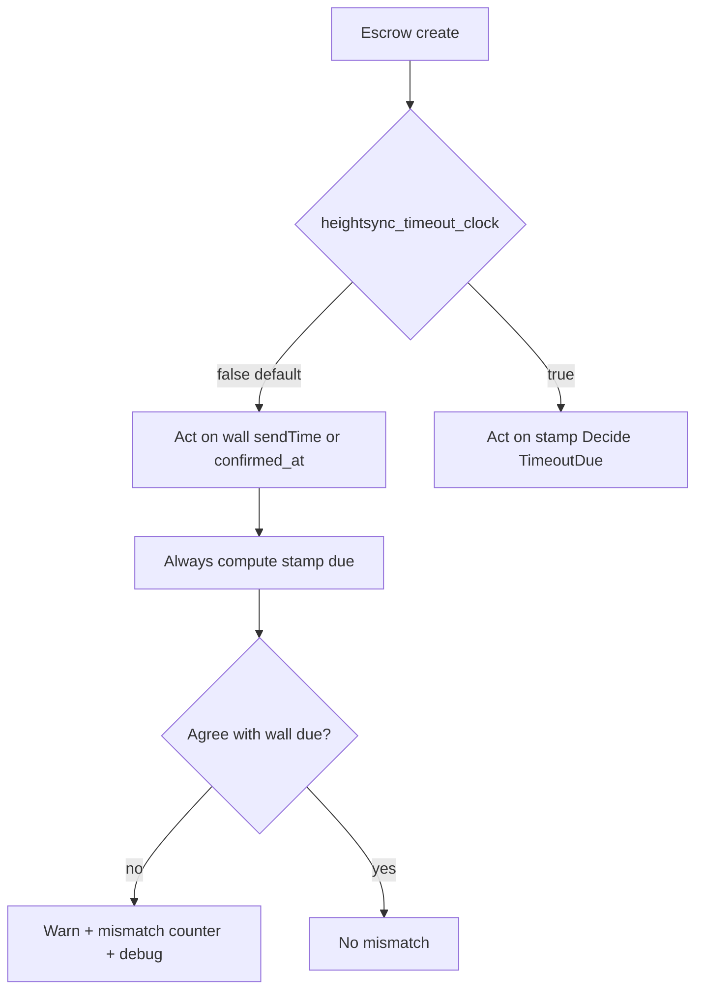

# Timeout clock dual-mode (legacy wall + stamp shadow)

**Status:** Done on this branch. Inference auto-seal and settlement drain still age carried stamp time against the floor. They do not follow `heightsync_timeout_clock`. Docker e2e needs `DEVSHARD_E2E=1`. Citest needs `TESTENV_CITEST=1`.  
**Related:** [async-header-time-timeout-plan.md](async-header-time-timeout-plan.md), [stamped-block-time-plan.md](stamped-block-time-plan.md)  
**Branches:** Track A is **only** `inference-chain/` on a separate branch → **0.2.18**. **This** branch owns every consumer of the flag (bridge, `SessionConfig`, due paths, mock-chain/e2e readers). No `inference-chain/` edits on this PR.

## Goal

One consensus-visible flag chooses which clock **acts** for refusal and execution timeouts:

| `heightsync_timeout_clock` | Active clock |
|---|---|
| **false** (default when chain omits it) | Legacy wall: wire `started_at` / `confirmed_at` |
| **true** | Stamp / header-time: `headertime.Decide`, carried `*TimeMs`, map, floor `TimeoutDue` |

When legacy is active, still **compute** the stamp due path on every relevant check. If wall due and stamp due disagree → **warn**, increment a **mismatch counter**, and expose it on **observability** endpoints. Do not change apply: timeout apply stays votes-only.

Do the steps in order. Each step’s test plan gates the next. All listed tests must pass before starting the next step. Update the status column as a step lands.

## Branch split

| Track | Branch | Allowed paths | Contents |
|---|---|---|---|
| **A. Chain (0.2.18)** | Separate branch → merge into **0.2.18** | **`inference-chain/` only** | Proto field on params + escrow, create freeze, defaults, upgrade backfill, chain query encoding of the field |
| **B. This branch** | Current async-header-time / timeout line | **Everything else** (`devshard/`, mock-chain under testenv, etc.) — **no `inference-chain/` commits** | Bridge **read** of the field, `SessionConfig`, wire wall clocks, DueEval, gateway/host, shadow + metrics, e2e/mock readers |

**Read path stays here.** `EscrowInfo` / `SessionConfigAtBind` / `SessionConfigFromEscrow` map `heightsync_timeout_clock` when the queried escrow carries it; if the field is absent (pre–0.2.18 chain), treat as **false**. After track A merges and nodes upgrade, the same code on this branch starts seeing `true` without a second consumer PR.

Until track A is live, e2e may set the flag via **mock-chain / testenv** YAML or host env that feeds the same bridge structs — still on this branch, not via editing `inference-chain/`.

## Steps

### Track A — inference-chain (0.2.18 branch)

| Step | Delivers | Status |
|---|---|---|
| [A1. Params + escrow proto](#step-a1-params--escrow-proto) | `heightsync_timeout_clock` on params and escrow | Done |
| [A2. Create freeze + defaults](#step-a2-create-freeze--defaults) | Create copies param; absent/zero → false | Done |
| [A3. Upgrade / query surface](#step-a3-upgrade--query-surface) | Old escrows stay false; query returns the field | Done |

### Track B — devshard

| Step | Delivers | Status |
|---|---|---|
| [B1. SessionConfig + bridge read](#step-b1-sessionconfig--bridge-read-this-branch) | Read path on this branch; missing → false | Done |
| [B2. Wire wall `started_at` / `confirmed_at`](#step-b2-wire-wall-started_at--confirmed_at) | Restore original wall field numbers | Done |
| [B3. Compose, sign, apply, state root](#step-b3-compose-sign-apply-state-root) | Fill wall on start/confirm; root includes wall, omits stamp `*TimeMs` | Done |
| [B4. Shared DueEval](#step-b4-shared-dueeval) | Legacy wall vs stamp Decide; mismatch bit | Done |
| [B5. Gateway acts on mode + shadows stamp](#step-b5-gateway-acts-on-mode--shadows-stamp) | `TimeoutDeadline` / wait / vote gate | Done |
| [B6. Verifier acts on mode + shadows stamp](#step-b6-verifier-acts-on-mode--shadows-stamp) | `VerifyRefusedTimeout` / `VerifyExecutionTimeout` | Done |
| [B7. Observability + divergence logging](#step-b7-observability--divergence-logging) | Prometheus counter, debug snapshot, warn logs | Done |
| [B8. Testenv dual-mode timeout suite](#step-b8-testenv-dual-mode-timeout-suite) | Mock-chain flag + run **all** timeout e2e/citest under both clocks | Done |

## Key decisions

- **Consensus flag.** Frozen at escrow create onto `DevshardEscrow`. Not a process env for production agreement (e2e may overlay env only when it matches the escrow).
- **Default false = legacy.** If inference-chain does not provide the field, behaviour is wall clocks.
- **Reuse original wall field numbers.** The stamp-only pass tombstoned wall `started_at` / `confirmed_at`; dual-mode restores the **same** `int64` Unix-second fields at the **same** numbers (not parallel tags). Reserving is for when meaning/type would change — here it does not.

| Message | Restored fields |
|---|---|
| `MsgStartInference` | `int64 started_at = 6` |
| `MsgConfirmStart` | `int64 confirmed_at = 3` |
| `ExecutorReceiptContent` | `int64 started_at = 6`, `int64 confirmed_at = 8` |
| `InferenceRecordProto` | `int64 started_at = 13`, `int64 confirmed_at = 14` |

- **Always write both clocks on start/confirm.** Wall + stamp on every message so records stay complete regardless of mode.
- **Shadow only when legacy.** Header mode acts on stamp only (no required wall shadow).
- **State root.** Wall `StartedAt` / `ConfirmedAt` from the signed message are included in `marshalInferenceEntry`. Stamp `StartedAtTimeMs` / `ConfirmedAtTimeMs` stay omitted (map-local noise must not move the root).
- **Apply timeout.** Votes only; no `TimeoutDue` re-check on apply.
- **Mismatch.** Compare active due vs stamp due (boolean due, and optionally deadline within a small epsilon). Warn + count; do not flip the active decision.



## Out of scope

- Flipping the flag mid-session on a live escrow  
- Changing AnswerWait or vote-only apply  
- Putting bridge / `SessionConfig` / mock readers on the 0.2.18 chain branch (those stay on **this** branch)  
- Putting any `inference-chain/` change on **this** branch (those stay on track A)

---

# Track A — inference-chain only (0.2.18)

Land on a **separate branch** whose diff is **restricted to `inference-chain/`**. Merge into **0.2.18**. Pattern matches `refusal_timeout` / `execution_timeout`. Do **not** add `devshard/` bridge or SessionConfig changes here — those are track B on this branch.

## Step A1. Params + escrow proto

[↑ Steps](#steps)

### Description

Add `bool heightsync_timeout_clock` to:

- `inference-chain/proto/inference/inference/params.proto` → `DevshardEscrowParams` field **20**
- `inference-chain/proto/inference/inference/devshard_escrow.proto` → `DevshardEscrow` field **19**

Regenerate Go types with `ignite generate proto-go`.

### Test plan

Gate for [A2](#step-a2-create-freeze--defaults).

- [x] Proto / generated types expose `HeightsyncTimeoutClock` on params and escrow.
- [x] Default zero value is false.

---

## Step A2. Create freeze + defaults

[↑ Steps](#steps)

### Description

- Defaults in `params.go`: `HeightsyncTimeoutClock: false`.
- Helper (e.g. `DevshardHeightsyncTimeoutClockForCreate`) like the timeout helpers in `devshard_escrow_timeouts.go`.
- `msg_server_create_devshard_escrow.go` copies the param onto the escrow at create.

### Test plan

Gate for [A3](#step-a3-upgrade--query-surface).

- [x] Create with default params → escrow `HeightsyncTimeoutClock == false`.
- [x] Create after governance sets param true → escrow true.
- [x] Validation / MsgUpdateParams accepts both values.

---

## Step A3. Upgrade + query encoding

[↑ Steps](#steps)

### Description

- Upgrade/backfill: existing escrows without the field remain false (proto3 zero; no store migration).
- Chain query / gRPC **encoding** includes `heightsync_timeout_clock` on the escrow message so clients can see it after 0.2.18.
- **Stop here on the chain branch.** Decoding into `EscrowInfo` / `SessionConfig` is track B on this branch (already prepared in B1).

### Test plan

Gate for shipping track A (chain-only).

- [x] Store load of a pre-field escrow → false.
- [x] Query escrow proto/JSON from the chain includes `heightsync_timeout_clock`.

---

# Track B — devshard

## Step B1. SessionConfig + bridge read (this branch)

[↑ Steps](#steps)

### Description

All **reading** of the flag lives here (not on the 0.2.18 chain branch):

- Add `HeightsyncTimeoutClock bool` to `SessionConfig` and `EscrowSessionFields` (`devshard/types`).
- Extend `EscrowInfo` / query mapping so a present `heightsync_timeout_clock` from chain (or mock-chain) is copied.
- `SessionConfigFromEscrow` / `SessionConfigAtBind`: copy when present; **missing / pre-0.2.18 → false** (no panic, no require).
- Optional e2e overlay only when it matches the escrow the bridge would see.

### Test plan

Gate for [B2](#step-b2-wire-wall-started_at--confirmed_at).

- [x] `SessionConfigFromEscrow` with zero fields → `HeightsyncTimeoutClock == false`.
- [x] Explicit true/false on `EscrowSessionFields` round-trips into `SessionConfig`.
- [x] Bridge bind with a stub escrow **omitting** the field → false.
- [x] Bridge bind with stub escrow **true** → `SessionConfig.HeightsyncTimeoutClock == true` (simulates post–0.2.18 chain without editing `inference-chain/` on this branch).

---

## Step B2. Wire wall `started_at` / `confirmed_at`

[↑ Steps](#steps)

### Description

Restore wall clocks at their **original** field numbers (drop the stamp-only `reserved` tombstones):

- `devshard/proto/devshard/v1/tx.proto` — `MsgStartInference.started_at = 6`, `MsgConfirmStart.confirmed_at = 3`
- `devshard/proto/devshard/v1/diff.proto` — `ExecutorReceiptContent.started_at = 6`, `confirmed_at = 8`
- `devshard/proto/devshard/v1/state.proto` — `InferenceRecordProto.started_at = 13`, `confirmed_at = 14`

Regenerate types. Domain `InferenceRecord` gains `StartedAt`, `ConfirmedAt int64`.

### Test plan

Gate for [B3](#step-b3-compose-sign-apply-state-root).

- [x] Marshal/unmarshal start and confirm with non-zero wall times preserves values.
- [x] Original field numbers are live again (not reserved); type is `int64`.
- [x] `ExecutorReceiptContent` includes wall fields in deterministic marshal used for `executor_sig`.

---

## Step B3. Compose, sign, apply, state root

[↑ Steps](#steps)

### Description

- Gateway compose start: set `StartedAt` from payload / send wall Unix; keep stamp `Observed*` as today.
- Host confirm: set `ConfirmedAt` from executor wall; put `started_at` (from record/payload) and `confirmed_at` into `ExecutorReceiptContent` before signing.
- `applyStartInference` / `applyConfirmStart`: copy wall onto the record with stamp heights / `ObservedTimeMs`.
- `marshalInferenceEntry`: include wall `StartedAt` / `ConfirmedAt`; still omit stamp `*TimeMs`.

### Test plan

Gate for [B4](#step-b4-shared-dueeval).

- [x] Compose start writes both wall and stamp fields.
- [x] Confirm receipt sig verifies only when wall fields match the signed body (tamper fails).
- [x] Apply copies wall onto live record.
- [x] Two records differing only in stamp `*TimeMs` share the same root entry; differing wall `StartedAt` changes the root.

---

## Step B4. Shared DueEval

[↑ Steps](#steps)

### Description

Production deadlines use `headertime.Due`. `EvalDue` / `wallPast` were removed; their strict-`After` check was not the v6 decision. The legacy sample is `CompareLegacyShadow`. The original helper shape was:

```text
DueEval {
  Active    // wall or stamp per HeightsyncTimeoutClock
  Shadow    // stamp Decide when Active is legacy; unset in header mode
  HasShadow
  Mismatch  // Active.Due != Shadow.Due (when HasShadow)
}
```

Acting legacy deadline: `Due`, due when `now` is not strictly before `Wall+Interval+Extra`. The deadline instant is due. A missing gateway anchor is unarmed. A verifier wall of Unix 0 is the epoch. Header follows `Decide`. The legacy stamp sample is `CompareLegacyShadow`.

### Test plan

Gate for [B5](#step-b5-gateway-acts-on-mode--shadows-stamp). Pins live in `protocol_due_test.go` and `legacy_shadow_test.go`.

- [x] Legacy deadline instant is due. One second before is not.
- [x] A missing gateway wall anchor is unarmed, including when the stamp would already be due.
- [x] A verifier wall of Unix 0 is the epoch and is due on the deadline.
- [x] Header: a past wall does not open a stamp that is still ahead. A due stamp opens while the wall is still ahead.
- [x] `Due` does not sleep or read the clock.

---

## Step B5. Gateway acts on mode + shadows stamp

[↑ Steps](#steps)

### Description

`TimeoutDeadline`, `WaitTimeoutDeadline`, and the vote gate call `headertime.Due`.

- Legacy refusal: the anchor is `sendTime` when it is set, including the Unix epoch. A zero `sendTime` uses the record `StartedAt` when that is positive. If both are missing the challenge stays unarmed. The deadline is that anchor plus `RefusalTimeout` plus `TimeoutBuffer`, and it is due when now is not strictly before it.
- Legacy execution: a queued confirm's wall time, then a started record's `ConfirmedAt`, plus `TimeoutBuffer`. A `Pending` record whose confirm was dropped clears that time and uses the refusal arm.
- Legacy shadow: `CompareLegacyShadow`, sampled once the wall arm is due. A missing stamp is logged and does not increment. The stamp does not open or block the vote.
- Header: `Due` follows the stamp. A past wall does not open the challenge.

### Test plan

Gate for [B6](#step-b6-verifier-acts-on-mode--shadows-stamp).

- [x] Legacy refusal opens on `sendTime` plus `TimeoutBuffer` when the stamp is not due. A missing stamp is logged and does not increment.
- [x] Header refusal does not open on wall alone when the stamp is not due.
- [x] Legacy execution uses the queued confirm, then wall `confirmed_at`. Header uses the stamp.
- [x] A zero `sendTime` uses `StartedAt` when that is positive, and stays unarmed when both are missing.

---

## Step B6. Verifier acts on mode + shadows stamp

[↑ Steps](#steps)

### Description

`awaitVerifierDue` branches on `HeightsyncTimeoutClock` (host `SessionConfig` via `verifierMap`):

- Legacy: `awaitVerifierLegacyDue` — wall `StartedAt` / `ConfirmedAt` is Active through `Due` with no `TimeoutBuffer`. A signed anchor of 0 is the Unix epoch. The stamp sample is `CompareLegacyShadow`. A missing stamp is logged and does not increment. Active does not wait `AnswerWait`.
- Header: existing stamp Decide / schedule / feed_behind loop (`awaitVerifierStampDue`).

### Test plan

Gate for [B7](#step-b7-observability--divergence-logging).

- [x] Legacy: wall due and stamp not due → the challenge can proceed and a mismatch is recorded. A missing stamp is logged and does not increment. Active does not wait `AnswerWait`.
- [x] Header: map miss still AnswerWait / feed_behind as today.
- [x] Duplicate-challenge memory unchanged for the active outcome.

---

## Step B7. Observability + divergence logging

[↑ Steps](#steps)

### Description

When legacy mode’s Active (wall) due disagrees with Shadow (stamp) due:

- Prometheus: `devshard_timeout_clock_mismatch_total{side="gateway|verifier",kind="refused|execution"}`.
- Warn log (structured): `escrow`, `nonce`, `reason`, `side`, `wall_due`, `stamp_due`, `wall_anchor` (unix or height), `stamp_ms`, `height` when known.
- Debug: `GET /v1/debug/timeout-clock` with `heightsync_timeout_clock`, `mismatch_total`, and last mismatch sample (escrow, nonce, reason, wall_due, stamp_due, wall_anchor, stamp_ms).

Header mode does not require a wall shadow; agreeing clocks must not warn or increment.

### Test plan

Gate for [B8](#step-b8-testenv-dual-mode-timeout-suite).

- [x] Unit: force wall due + stamp not due → counter `+1` for the correct `{side,kind}` labels.
- [x] Unit: same force → warn log contains the structured fields above (capture via test logger / zap observer).
- [x] Unit: debug JSON after a mismatch includes mode=`false`, `mismatch_total >= 1`, and the last sample’s wall_due/stamp_due.
- [x] Unit: wall and stamp both due → no warn, counter unchanged.
- [x] Unit: header mode (`HeightsyncTimeoutClock=true`) with stamp due → no mismatch counter / no divergence warn even if wall would disagree.
- [x] Gateway and verifier each have at least one mismatch test (both `side` labels covered).

---

## Step B8. Testenv dual-mode timeout suite

[↑ Steps](#steps)

### Description

Wire `heightsync_timeout_clock` through **mock-chain / testenv** so every timeout protocol test runs under **both** clocks — not a single optional smoke.

1. **Mock-chain / seed / harness**
   - Params + per-escrow YAML/JSON field `heightsync_timeout_clock` (default false).
   - Create/freeze onto mock `DevshardEscrow` the same way as Track A (so bridge `EscrowInfoFromQuery` / bind see it).
   - Citest harness option (e.g. `HarnessOpts.HeightsyncTimeoutClock *bool` or compose env) that sets escrow + host/gateway session config consistently.
   - No process-only env that disagrees with the escrow the bridge would return.
   - E2E hosts are `devshard-host`. They do not query the escrow. `timeoutProtocolEnvOptions` sets `DEVSHARD_HEIGHTSYNC_TIMEOUT_CLOCK` on every host to the same value the mock chain freezes on the seed escrow. Unset is legacy.

2. **Dual run**
   - Factor shared timeout suites so each case runs twice: `legacy` (`false`) and `header` (`true`).
   - Prefer table/`t.Run("legacy"|"header", …)` or a small harness helper over copy-paste.
   - **All** timeout-oriented e2e / citest / testenv protocol tests in this list must pass in both modes (extend the list if new timeout tests land):
     - `TestE2E_TimeoutProtocolEndToEnd` (refusal)
     - `TestE2E_ExecutionTimeoutProtocolEndToEnd`
     - citest timeout evidence / related timeout protocol tests under `testenv/citest` that assert open/vote/apply behaviour
     - any other e2e already fixed for header-follow / wall open that gates timeout challenges

3. **Mode-specific expectations**
   - **Legacy:** wall open is enough for Active due; stamp shadow may mismatch (counter/log allowed); keep host header follow so stamp path can still complete where the suite asserts stamps.
   - **Header:** stamp/`Decide` due required; wall-only early open must **not** open or apply a timeout without stamp due; suites that previously relied on wall alone need map/carried time setup (same header-follow helpers already used on this branch).

### Test plan

Gate for calling the dual-mode work **done**.

- [x] Mock-chain seed/create persists and queries `heightsync_timeout_clock` (false default, true when set).
- [x] Harness can bind a session with the flag true without editing `inference-chain/` on this PR (stub / mock-chain field).
- [x] Refusal timeout suite runs under **legacy** and **header** (`TestE2E_TimeoutProtocolEndToEnd`). It compiles and skips without `DEVSHARD_E2E=1`.
- [x] Execution timeout suite runs under **legacy** and **header** (`TestE2E_ExecutionTimeoutProtocolEndToEnd`). It compiles and skips without `DEVSHARD_E2E=1`.
- [x] Header e2e sets `DEVSHARD_HEIGHTSYNC_TIMEOUT_CLOCK=true` on every host to match the escrow. Each host's `GET /debug/timeout-clock` matches the gateway session clock. Legacy leaves the env unset.
- [x] Citest timeout evidence runs under **both** (`TestTimeoutEvidence`). It compiles with `-tags testenvci` and skips without `TESTENV_CITEST=1`.
- [x] Header-mode case: wall past timeout but stamp not due → no timeout apply / no challenge open.
- [x] Legacy-mode case that forces wall/stamp disagree → B7 counter or warn visible in testenv logs or debug (at least one cross-check).

---

## Rollout

1. Merge track B with default false (behaviour ≈ today’s wall refusal + restored wire fields + shadow metrics).
2. Merge track A into **0.2.18**; deploy chain.
3. Governance may set `heightsync_timeout_clock=true` for new escrows when stamp clocks are trusted in prod.
4. Watch `devshard_timeout_clock_mismatch_total` under legacy before flipping.
5. Keep B8 dual-run green on every timeout change so flipping governance does not rediscover suite gaps.
