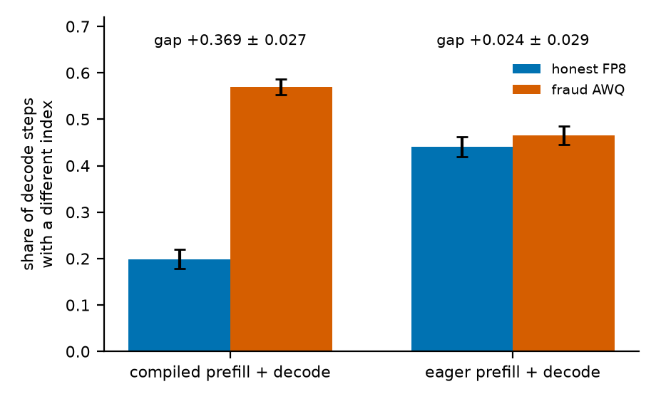
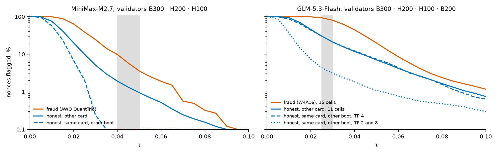
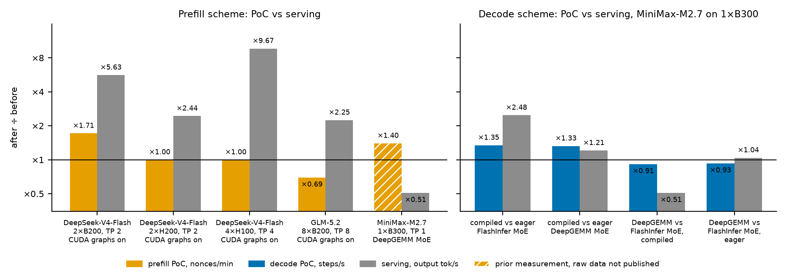
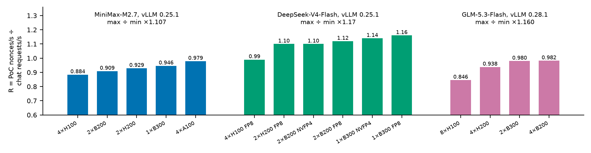

# Proof of Compute in gonka: the prefill and decode schemes

How a node computes a PoC artifact under each scheme, how another node checks it, and how each scheme's throughput relates to chat. The mechanism follows the plugin [`gonka-ai/gonka-vllm-plugins` @ `e6988c0`][plugin], with file names under `src/gonka_poc/`, the engine [`gonka-ai/vllm` @ `91099f9`][engine] and the chain, DAPI and MLNode of [gonka-ai/gonka#1871][pr1871], all in `ghcr.io/gonka-ai/mlnode:4.0.0-sigma1`. The short version, with the formulas, is [gonka-poc-schemes.md](gonka-poc-schemes.md).

## 1. Terms

- **Nonce**: an integer. With the block hash and the node's public key it fully determines one PoC computation.
- **Artifact**: what a node reports for a nonce.
- **Prover**: the node that computed an artifact. **Validator**: a node that recomputes a sample of them.
- **PoC row**: a sequence in a batch that belongs to a PoC computation rather than a chat request.
- **Eager**: PyTorch runs the model op by op, without CUDA graphs or torch.compile.

## 2. Common to both schemes

**Input.** A PoC sequence has no tokens. Its input embeddings are drawn from a normal distribution seeded by (block hash, public key, nonce) ([`poc/gpu_random.py`][gpu_random]). Models that also read token ids get deterministic pseudo ids.

**Layer reflections.** After every decoder layer `i`, the hidden state and the residual of PoC rows are reflected: `x ← x − 2(x·vᵢ)vᵢ`. `vᵢ` is a unit vector seeded by (block hash, `i`). It is the same on every node and changes with every block ([`poc/layer_hooks.py`][layer_hooks]).

**Mining round.** Each node, and each vLLM instance within it, takes nonces from its own disjoint sequence, computes their artifacts and posts them to the node's API. Chat requests get 503 for the whole round ([`poc/routes.py`][routes]).

**Verdict.** The validator recomputes a sample of `n` of the prover's nonces and flags each nonce whose result differs from the prover's by more than a per-model threshold. The prover is declared fraudulent if an honest node would flag that many nonces with probability below α. Honest nodes are assumed to be flagged at rate `p_mismatch`, and the test is one-sided binomial: `P(X ≥ flagged | n, p_mismatch) < α`. With `n` = 200 and `p_mismatch` = 0.1 (the mainnet values), that means 28 or more flagged nonces at α = 0.05 and 31 or more at α = 0.01. The threshold, `p_mismatch` and α are per-model chain parameters, one set per scheme ([`poc/data.py`][data], [`poc/validation.py`][validation]).

## 3. Prefill scheme

The node computes a batch of `B` nonces at once, 32 by default (`POC_BATCH_SIZE_DEFAULT`), in [`poc/poc_model_runner.py`][poc_model_runner]:

1. Build input embeddings for `B` sequences of 1024 positions each.
2. Run one eager forward of the model over the `B × 1024` positions. The plugin calls the workers directly, so the vLLM scheduler is not involved. The layer reflections of §2 apply, and MoE layers keep the model's own routing.
3. For each sequence, take the model's output hidden state at the last position and normalise it to unit length.
4. Keep 12 of its coordinates, chosen by a seed from (block hash, public key, nonce). Rotate these 12 values by a seeded random rotation (11 Householder reflections), and normalise again.
5. The artifact is these 12 values in fp16, 24 bytes.

**Check.** The validator recomputes the artifact. A nonce is flagged if the L2 distance between the two 12-dimensional unit vectors exceeds the threshold.

## 4. Decode scheme

Each nonce is a generation request of 256 new tokens after a 256-position prompt of seeded embeddings. It runs through the vLLM scheduler like a chat request: continuous batching, CUDA graphs, and torch.compile where the model uses it. On its rows the plugin changes the model as follows; chat rows in the same batch are untouched ([`mixed/native.py`][native]):

- The layer reflections of §2 apply.
- In every MoE layer the router's choice is replaced. The `k` experts are `k` consecutive expert indices starting at a position seeded by (block hash, nonce, layer, step), with fixed decreasing router logits ([`poc/decode_random.py`][decode_random]).
- The sampler is skipped. Each step instead produces an index `k_t`:
  1. At position `t` take the model's output hidden state. Position 0 is the last prompt position, and positions 1–256 are the generated ones.
  2. Pick 256 of its coordinates by a seed from (nonce, `t`, `k_{t−1}`) and normalise them to unit length.
  3. Compute the cosine with each of 16 fixed unit vectors in 256 dimensions. This is the codebook: a file shipped with the plugin, whose sha256 is checked at load ([`poc/sphere.py`][sphere]).
  4. `k_t` is the index of the closest of the 16.
- The input of step `t + 1` is not a token embedding but a normal vector seeded by (nonce, `t + 1`, `k_t`). Step `t + 1` cannot start before `k_t` is known, so the 256 steps of a nonce run strictly in order.

**Artifact.** The 257 indices `k_0 … k_256`, 4 bits each, sent one byte per index.

**Check** ([`poc/validation.py`][validation]):

1. The validator replays the nonce, but at every step it feeds the prover's `k_t`, not its own, into step `t + 1`. Both sides therefore run the same 257 positions.
2. At each step it has its own 16 cosine scores. The margin is `m_t = max score − score[prover's k_t]`: 0 when the two agree, small when the hidden state lies near a boundary between two codebook vectors, large when the prover's index is far off. An index outside 0–15 counts as margin 2.
3. The nonce is flagged if `max_t m_t > τ`.

Validation runs next to chat: while PoC rows are in the engine, chat is paused ([gonka-ai/vllm#121][pr121]).

τ must be above 0 because honest hardware disagrees on some steps by small margins. The same card after a reboot disagrees on 2–13 % of steps, and another card on 7–14 %; fraud measured 12–42 %. The proposed τ values are 0.04–0.05 for MiniMax-M2.7, 0.025–0.03 for GLM-5.3-Flash and 0.05 for DeepSeek-V4-Flash.

The prover and the validator must also run the same engine configuration. Compiled, an honest validator on another card disagrees on 20 % of steps and a quantised (AWQ) checkpoint on 57 %. Eager, the two are at 44 % and 47 %, too close to tell apart (Figure 1).

*Figure 1. MiniMax-M2.7 nonces validated on another card: share of decode steps whose index differs from the prover's, 64 nonces, 95 % CI. Data: `2026-06/decode-poc-separability-compiled-vs-eager`.*

*Figure 2. Share of nonces flagged as τ grows, for honest validators (same card after a reboot, another card) and for fraud (a quantised checkpoint). Grey band: the proposed τ. Data: `2026-09/decode-poc-0251-freeze` (MiniMax), `2026-09/decode-poc-0281-glm-freeze` (GLM).*

**Mining on a node** ([`poc/routes.py`][routes]). The node keeps up to `N` nonces in flight, where `N` is the number of sequences the engine runs at once. The first `N` start in four groups 8 s apart. Each finished nonce is posted at once and replaced by the next, so the groups stay offset and finished nonces arrive continuously.

## 5. Side by side

| | prefill | decode |
|---|---|---|
| positions per nonce | 1024, one forward | 256 prompt + 256 generated |
| execution | eager, outside the scheduler | the chat path: scheduler, CUDA graphs, torch.compile |
| MoE routing | the model's router | seeded experts |
| order within a nonce | all positions in parallel | 256 sequential steps |
| artifact | 12 fp16 values, 24 B | 257 indices out of 16, 257 B |
| validator input | none | the prover's 257 indices |
| per-nonce distance | L2 of two 12-dim unit vectors | largest margin over the 257 steps |

## 6. Throughput: decode PoC follows chat

Prefill PoC is one eager forward outside the scheduler. Engine changes that speed up chat therefore barely move it, or move it the other way. Decode PoC runs on the chat path, so the same changes move both (Figure 3).

*Figure 3. Throughput after ÷ before one engine change, on the same hardware and image. Left, prefill: CUDA graphs raise chat 2.25–9.67× but prefill PoC only 0.69–1.71×, and DeepGEMM MoE on MiniMax halves chat while prefill PoC rises (hatched: an earlier measurement without raw data). Right, decode on MiniMax-M2.7, 1×B300, mean of three runs: compilation raises both, and DeepGEMM instead of FlashInfer MoE lowers both, except in the eager engine (PoC ×0.93, chat ×1.04). Data: `2026-06/glm-5.2-deepgemm-8xb200`, `2026-07/deepseek-v4-flash-*`, `2026-06/decode-poc-goodhart-deepgemm-vs-flashinfer`.*

Figure 4 uses R = PoC nonces/s ÷ chat requests/s at peak concurrency. A nonce and a chat request both have 256 prompt and 256 generated tokens. Across 15 hardware configurations, R stays within a factor of 1.11 for MiniMax-M2.7, 1.17 for DeepSeek-V4-Flash and 1.16 for GLM-5.3-Flash. Decode PoC therefore credits each configuration roughly in proportion to its chat capacity.

*Figure 4. R per hardware configuration, at the launch settings of the vLLM 0.25.1 (MiniMax, DeepSeek) and 0.28.1 (GLM) decode releases. Data: `2026-09/decode-poc-0251-freeze`, `2026-09/decode-poc-0281-glm-freeze`.*

## 7. On the chain and on a node

- **Chain** ([`params.proto`][params_proto], [`poc_stage_recipe.go`][recipe]). `PocParams.poc_scheme` is PREFILL or DECODE. Each model has one block per scheme in `PoCModelConfig.schemes`: `seq_len`, `max_tokens` (256 for decode, 0 for prefill), `stat_test` and `dynamic_coefficient`. A stage reads the blocks frozen at its start, so a change applies from the next stage.
- **DAPI** ([`poc_v2.go`][poc_v2], [`validator.go`][validator]). A trajectory is stored one byte per step, and values outside 0–15 are rejected. The sample goes to MLNode with the model's `stat_test`.
- **Images.** `4.0.0-sigma1`; `4.0.0-sigma1-minimaxxer` adds prefill speedups and keeps decode unchanged; `4.0.0-sigma1-cu12` runs on drivers older than 580.
- **Node configs** ([`deploy/join`][deploy_join]). Per model and GPU: the release config, `-prefill-max` and `-decode-max`. Decode does not run pipeline-parallel, so a node on a pipeline-parallel config switches before a decode stage, with `PUT /admin/v1/nodes/<id>` during inference.
- **Node check** ([gonka-ai/gonka#2060][pr2060]). `validate.py --scheme decode` validates a node against 200-nonce golden references.

## 8. Sources

- Plugin [`gonka-ai/gonka-vllm-plugins` @ `e6988c0`][plugin], the `decode/vlm030` branch:
  - prefill: [`poc/gpu_random.py`][gpu_random], [`poc/layer_hooks.py`][layer_hooks], [`poc/poc_model_runner.py`][poc_model_runner];
  - decode: [`poc/decode_random.py`][decode_random], [`poc/sphere.py`][sphere], [`mixed/native.py`][native], [`mixed/runtime.py`][runtime];
  - verdict: [`poc/validation.py`][validation], [`poc/data.py`][data];
  - mining: [`poc/routes.py`][routes].
- Engine [`gonka-ai/vllm` @ `91099f9`][engine]: [#116][pr116] (scheduler and runner hooks), [#121][pr121] (chat pause).
- Chain, DAPI, MLNode and node configs: [gonka-ai/gonka#1871][pr1871].
- Scheme proposal [gonka-ai/gonka#1135][i1135]; [gonka-poc-schemes.md](gonka-poc-schemes.md).
- Measurements: [`kaitakuai/experiments` @ `cdf6d28`][experiments]. Each figure caption names its directories, and the disagreement rates and τ come from `2026-09/decode-poc-0251-freeze` and `2026-09/decode-poc-0281-glm-freeze`.
- Figures: [`gonka-decode-poc-whitepaper/make_figures.py`](gonka-decode-poc-whitepaper/make_figures.py).

[plugin]: https://github.com/gonka-ai/gonka-vllm-plugins/tree/e6988c0652a27259fa834310d636a478db948fb9
[engine]: https://github.com/gonka-ai/vllm/tree/91099f99a1de43bde16d5a8860f5fe9d46aff377
[pr1871]: https://github.com/gonka-ai/gonka/pull/1871
[pr2060]: https://github.com/gonka-ai/gonka/pull/2060
[pr116]: https://github.com/gonka-ai/vllm/pull/116
[pr121]: https://github.com/gonka-ai/vllm/pull/121
[i1135]: https://github.com/gonka-ai/gonka/issues/1135
[experiments]: https://github.com/kaitakuai/experiments/tree/cdf6d28603c956b5694cb73c11011de8e95719e6
[gpu_random]: https://github.com/gonka-ai/gonka-vllm-plugins/blob/e6988c0652a27259fa834310d636a478db948fb9/src/gonka_poc/poc/gpu_random.py
[layer_hooks]: https://github.com/gonka-ai/gonka-vllm-plugins/blob/e6988c0652a27259fa834310d636a478db948fb9/src/gonka_poc/poc/layer_hooks.py
[poc_model_runner]: https://github.com/gonka-ai/gonka-vllm-plugins/blob/e6988c0652a27259fa834310d636a478db948fb9/src/gonka_poc/poc/poc_model_runner.py
[decode_random]: https://github.com/gonka-ai/gonka-vllm-plugins/blob/e6988c0652a27259fa834310d636a478db948fb9/src/gonka_poc/poc/decode_random.py
[sphere]: https://github.com/gonka-ai/gonka-vllm-plugins/blob/e6988c0652a27259fa834310d636a478db948fb9/src/gonka_poc/poc/sphere.py
[native]: https://github.com/gonka-ai/gonka-vllm-plugins/blob/e6988c0652a27259fa834310d636a478db948fb9/src/gonka_poc/mixed/native.py
[runtime]: https://github.com/gonka-ai/gonka-vllm-plugins/blob/e6988c0652a27259fa834310d636a478db948fb9/src/gonka_poc/mixed/runtime.py
[validation]: https://github.com/gonka-ai/gonka-vllm-plugins/blob/e6988c0652a27259fa834310d636a478db948fb9/src/gonka_poc/poc/validation.py
[data]: https://github.com/gonka-ai/gonka-vllm-plugins/blob/e6988c0652a27259fa834310d636a478db948fb9/src/gonka_poc/poc/data.py
[routes]: https://github.com/gonka-ai/gonka-vllm-plugins/blob/e6988c0652a27259fa834310d636a478db948fb9/src/gonka_poc/poc/routes.py
[params_proto]: https://github.com/gonka-ai/gonka/blob/c7a8a44f3e931bc33d93f71c4767d05f9cb9df1c/inference-chain/proto/inference/inference/params.proto
[recipe]: https://github.com/gonka-ai/gonka/blob/c7a8a44f3e931bc33d93f71c4767d05f9cb9df1c/inference-chain/x/inference/keeper/poc_stage_recipe.go
[poc_v2]: https://github.com/gonka-ai/gonka/blob/c7a8a44f3e931bc33d93f71c4767d05f9cb9df1c/decentralized-api/mlnodeclient/poc_v2.go
[validator]: https://github.com/gonka-ai/gonka/blob/c7a8a44f3e931bc33d93f71c4767d05f9cb9df1c/decentralized-api/poc/validator.go
[deploy_join]: https://github.com/gonka-ai/gonka/tree/c7a8a44f3e931bc33d93f71c4767d05f9cb9df1c/deploy/join
